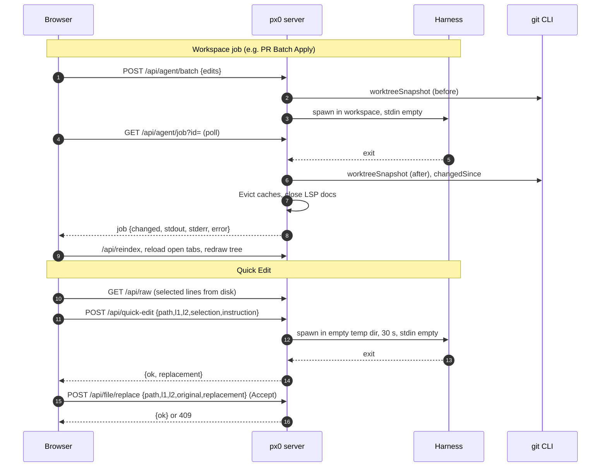

# Harness Editing & Agent Dispatch

This document describes how px0 runs a coding harness and what it does with the result:

- harness selection, workspace jobs and change detection: [`agent.go`](../../agent.go)
- Quick Edit's one-shot run: [`quickedit.go`](../../quickedit.go), [`web/src/quick_edit.js`](../../web/src/quick_edit.js)
- the guarded line replacement Quick Edit accepts through: [`replace.go`](../../replace.go)
- the persisted harness choice: [`internal/settings/settings.go`](../../internal/settings/settings.go)
- the harness/model selects shared by every panel that runs a harness: [`web/src/agent.js`](../../web/src/agent.js)
- presets, discovery and the process runner: the [`github.com/px0-ai/harness`](https://github.com/px0-ai/harness) module

Harnesses are discovered automatically, the same way language servers are, but nothing runs until the user picks one, and that choice is remembered between runs. `-no-agent` removes every harness-backed feature; `-agent` pins a harness for scripted use and takes the choice away from the UI.

## 1. The Dispatcher Model

px0 does not author changes itself. Every harness-backed feature hands a prompt to a harness already installed on the machine and uses what comes back. There are two shapes:

| Shape | Callers | Working directory | Result |
| --- | --- | --- | --- |
| **Workspace job** (`agentManager.StartPrompt`, `StartEdit`) | Commit message and commit plan, Rebase / Merge with AI, PR merge message, PR Batch Apply | The workspace root | An `agentJob` polled through `/api/agent/job`; whatever the harness wrote is detected and reloaded (sections 5 and 6) |
| **Quick Edit** (`handleQuickEdit`) | The editor's Quick Edit box | A fresh empty temp folder | The replacement text in the HTTP response; px0 writes it only on Accept, through `/api/file/replace` (section 4) |

The hot path (indexing, highlighting, navigation) is untouched by either.



## 2. Discovery, Selection and the Settings File

`Detect` walks the preset list and resolves each harness with the harness module's `LookPath`, which covers PATH plus the directories these tools actually install into, such as `~/.local/bin` and npm's global prefix. It runs on every `/api/agent/harnesses` call, so a harness installed after startup appears without a restart. Each harness's model list comes from the harness itself (`claude -p /model`, `cursor-agent --list-models`, `agy models`, `opencode models`, `codex debug models`) and is cached for the life of the process.

Discovery alone never enables a harness. Finding `claude` on PATH is not consent to run it over a workspace, so the choice is explicit. `registerAgentPicker()` in `agent.js` keeps every harness/model select pair in sync (the git panel's notice card, the PR merge dialog): a change in any of them calls `/api/agent/select` and redraws the rest. With nothing chosen yet, each select leads with a disabled **pick a harness** entry, so the first installed harness never looks chosen while the server has none. When `-agent` pinned the harness, the selects are disabled and `/api/agent/select` refuses.

The choice is written to:

```
$XDG_CONFIG_HOME/px0/settings.json     # when XDG_CONFIG_HOME is set
~/.px0/settings.json                   # otherwise
```

```json
{
  "agent": "claude",
  "models": { "claude": "haiku" }
}
```

px0 never writes its own state into a working tree: there is no `.px0/` directory in the repository.

A corrupt or stale settings file is never an error. If the saved harness has since been uninstalled it resolves to nothing selected, and the selects ask again.

The spec is persisted exactly as the user gave it. A command template shortens to its binary name for display, so saving the display name would break the round trip.

## 3. The Invocation Contract

Every supported harness starts an interactive session by default and blocks on an approval prompt. A naive spawn therefore hangs forever, producing no output and no error. Each preset carries both the flag that makes the run headless and the flag that lets it apply edits unattended:

| Harness | Argv | Model flag |
| --- | --- | --- |
| `claude` | `claude --permission-mode acceptEdits -p {prompt}` | `--model` |
| `cursor-agent` | `cursor-agent --force -p {prompt}` | `--model` |
| `agy` | `agy --dangerously-skip-permissions --mode accept-edits -p {prompt}` | `--model` |
| `opencode` | `opencode run {prompt}` | `-m` |
| `codex` | `codex exec --skip-git-repo-check --sandbox workspace-write {prompt}` | `-m` |

When a model is chosen, its flag is inserted just before the prompt (before `-p` when the prompt follows one). With no model chosen, the harness's own default applies.

A full command template is accepted anywhere a harness name is, and must contain `{prompt}`; `{model}` is substituted too when present:

```bash
px0 -agent "claude -p --permission-mode acceptEdits {prompt}"
```

The template is split on whitespace, and `{prompt}` is substituted inside each token, so both `{prompt}` and `--prompt={prompt}` work. The prompt is always one argument and never passes through a shell. Presets are a convenience, not a coupling: a harness that changes its flags is a one-line template fix for the user rather than a px0 release.

The binary is resolved before a harness can be selected, so a typo or an uninstalled tool fails at the point of choosing rather than on first use.

### Stdin Stays Empty

The harness gets no stdin. A harness that still decides to ask something reads EOF and exits, which surfaces as an error. This is the difference between a failed run and a hung one.

### Process Groups and Time Limits

The harness runs in its own process group, and cancel or timeout kills the whole group, so helpers it started do not outlive it. A workspace job is abandoned after 10 minutes; Quick Edit after 30 seconds.

### Streaming and Output

During a workspace job, lines from stdout and stderr stream to the terminal where px0 is running (`lineStreamer`), and are kept in `tailBuffer`s (the last 32 KB of each) for `/api/agent/job`. A failed job comes back with an `error` field and both tails, so the UI can show the harness's own explanation (an invalid API key, a missing login) instead of a bare status.

## 4. Quick Edit

`handleQuickEdit` (`POST /api/quick-edit`, `{path, l1, l2, selection, instruction}`) runs the selected harness once and returns the lines that should replace the selection. It never touches the workspace:

1. The browser reads the selected lines whole from `/api/raw` (the editor's own rows are highlighted HTML and only partly loaded) and sends them as `selection`, keeping a copy as `original` for Accept.
2. The prompt carries the path, the line range, the selected code and the instruction, and asks for the replacement inside `<replacement>…</replacement>` tags, without modifying any file.
3. The harness runs in a fresh `os.MkdirTemp` directory, removed afterwards, with stdin empty and a 30-second timeout bound to the request's context. Closing the box aborts the fetch, which cancels the context and kills the harness.
4. `parseQuickEditOutput` takes the **last** `<replacement>` block, or failing that the last fenced code block: a model may quote the format before using it. `trimBlock` drops blank lines around the block but keeps the first line's indentation, which is part of the code being replaced.
5. A harness error (with its stderr) or a reply with neither block is a `422` with the message, shown in the box.

The response is `{ok: true, replacement}`. `quick_edit.js` renders the selected lines as `-` rows and the replacement as `+` rows. Nothing is written until Accept.

### Accept: `/api/file/replace`

`handleFileReplace` (`POST`, `{path, l1, l2, original, replacement}`) is a compare-and-swap on a line range:

- The range is checked against the file's lines (a trailing newline is not a line): out of bounds is a `400`.
- Lines `l1..l2` are compared with `original`, ignoring CRs on both sides. Any difference is a `409` "File was modified on disk", and nothing is written. Quick Edit's preview was made from those lines, and an agent or the user may have changed them since.
- In a file that contains CRLF, every replacement line gets a CR, except that the range's last line keeps whatever ending it had: a final line without a newline gets no CR either.
- An empty `replacement` deletes the lines.
- After the write, the render cache entry is evicted, the language servers close and refresh the document, the index is touched, and the git watcher is triggered. The browser then reloads open tabs.

Quick Edit is offered only in the source view and is refused while the file is open for manual editing, where the buffer may differ from disk.

## 5. Workspace Jobs and the Overlap Guard

`agentManager` keeps every job in `jobs map[int64]*agentJob`. Two entry points share `startLocked` and `run`:

- `StartPrompt(label, prompt)` for jobs that answer rather than edit a range: the commit message and plan (`handleGitCommitMessage`, `handleGitCommitPlan`, see [Git Awareness](git-integration.md)), Rebase / Merge with AI (`handleGitSyncAgent`), and the PR merge message (`pr.go`). No range, no overlap check.
- `StartEdit(items)` for PR Batch Apply (`POST /api/agent/batch`, `{edits: [{path, l1, l2, instruction}]}`). `editPrompt` quotes each item's lines from disk (capped at 8,000 bytes each) with its instruction, and asks the harness to carry them out in place and reply with a short summary.

`StartEdit` refuses two items in the same batch whose ranges overlap, and refuses a batch whose ranges intersect a batch still running on the same path (`overlappingLocked`, a `409`): two harnesses rewriting the same lines leave a state nobody can review. Disjoint ranges and prompt jobs run concurrently.

Edits on files with uncommitted changes proceed without a prompt.

## 6. Determining What Changed

A harness routinely edits files nobody pointed it at, so the set of touched files is never inferred from the prompt. `changedSince` compares a `worktreeSnapshot` taken before the run with one taken after, in both directions:

- A path whose entry is new or different was touched.
- A path that has left the list entirely was restored to its committed state, which is also a change.

`worktreeSnapshot` is `gitStatus` with each listed file's size and modification time folded into its entry. Status alone misses the most common case in review: editing a file that is already modified reads `M` before and after, so the edit would go unseen and nothing would reload. Clean files are not stamped; a change to one surfaces through status on its own.

The set is sorted by path, since both snapshots are maps and Go randomises their iteration order.

Outside a git repository there is no status to compare, so the job reports `tracked: false` and an empty change list. The client treats that as "unknown" rather than "nothing" and reloads the workspace regardless.

## 7. The Reload Path

The syntax highlighting cache memoises on `path + mtime + size` ([`internal/render/render.go`](../../internal/render/render.go)), so a rewritten file misses the cache on its own. Two things still need explicit handling (`settle`):

- Torn reads. `Open` stats and then reads, non-atomically. A harness that truncates and writes in place can be caught mid-write, and that partial copy would then sit under a cache key nothing invalidates. Every changed file is therefore passed to `Evict`.
- Stale language servers. `gopls` and friends hold their own copy of a file and never saw the write. Each changed file is passed to `lsp.CloseDoc`, and the server reopens it on the next request.

The frontend's `reloadWorkspace()` in `agent.js` then reloads in dependency order: `/api/reindex` first so the tree and git badges agree with disk, then `reloadOpenTabs()`, then a tree redraw. Reloads are queued (`reloadChain`) so two runs finishing close together don't interleave their requests.

### Each Tab Keeps Its View

`reloadOpenTabs()` keeps each tab in the view it was in. A tab in source view stays in source even though the file now has a diff; the tab is marked `diffDismissed` so the gutter load does not flip it either. A tab in the diff view stays there, refetches `/api/diff`, and restores its scroll position (`diffScroll`). Scroll position, cursor line and Markdown preview scroll are preserved.

### No File Watcher for Jobs

px0 started the harness, so it knows when the work ended: completion is the process exiting, not a filesystem event.

## 8. HTTP Surface

| Endpoint | Method | Purpose |
| --- | --- | --- |
| `/api/agent/harnesses` | GET | Re-scan and list every known harness with its installed state and models. |
| `/api/agent/select` | POST | Choose a harness (and model) and remember it. An empty name turns it off. Refused when `-agent` pinned one. |
| `/api/agent/batch` | POST | Run `{edits: [...]}` as one workspace job (PR Batch Apply). `409` when a range overlaps a running batch. |
| `/api/agent/job` | GET | Snapshot of job `?id=`, or the most recently started job when `id` is omitted. Polled while running. |
| `/api/agent/cancel` | POST | Stop job `id`, or every running job when `id` is omitted. Whatever each already wrote stays. |
| `/api/quick-edit` | POST | `{path, l1, l2, selection, instruction}` → `{ok, replacement}`. `422` with the message on a harness error or unparseable reply. |
| `/api/file/replace` | POST | `{path, l1, l2, original, replacement}` → `{ok}`. `409` when the lines no longer read `original`. |
| `/api/git/commit-message`, `/api/git/commit-plan`, `/api/git/sync-agent`, `/api/pr/merge-message` | POST | Start a prompt job; see [Git Awareness](git-integration.md) and [Pull Request Review](github-pr-review.md). |

A job snapshot:

```json
{
  "id": 3,
  "harness": "claude",
  "path": "2 edits",
  "lines": "",
  "running": false,
  "error": "exit status 1",
  "stdout": "…",
  "stderr": "…",
  "log": "…",
  "changed": ["server.go"],
  "tracked": true,
  "ms": 4425
}
```

`/api/meta` carries `agent` (the selected name, or empty), `agentModel` and `agentPinned`, and an empty `agents` list; the browser fills the detected list from `/api/agent/harnesses` after boot, so model discovery never delays the first paint.

Every mutating endpoint is guarded by `localPost` ([`server.go`](../../server.go)): POST only, `Origin` must match `Host`, and `Host` must be an IP address or `localhost`, which shuts out DNS rebinding.

### Security Posture

A workspace job runs a general-purpose coding agent with shell access as the user who started px0. Quick Edit runs the same agent, only from an empty folder: that keeps it from changing the workspace through its working directory, but it is not a sandbox. `localPost` restricts both to px0's own page reached by IP address or `localhost`. That shuts out other websites and DNS rebinding, and makes these features unavailable through the hostname-based tunnels and reverse proxies described in the README. It is not authentication: with `-host 0.0.0.0`, anyone who can reach px0 by IP, for example over Tailscale, can start a run.

The explicit first pick matters for the same reason. Auto-enabling on discovery would make any px0 instance on a machine with a harness installed a code execution endpoint that nobody opted into.

## 9. Limits

- A workspace job keeps the last 32 KB of each of stdout and stderr, enough to explain a failure without holding a full transcript.
- A workspace job is abandoned after 10 minutes, Quick Edit after 30 seconds.
- Changes to gitignored files are invisible to `git status`, so a workspace job's edits to them are never reloaded.
- Jobs live in memory for the life of the process. Only the harness and model choice are persisted, and never inside a workspace.
- Closing the browser does not stop a workspace job; it runs to completion or timeout in the server. Closing the Quick Edit box, or the page, cancels a Quick Edit run.
