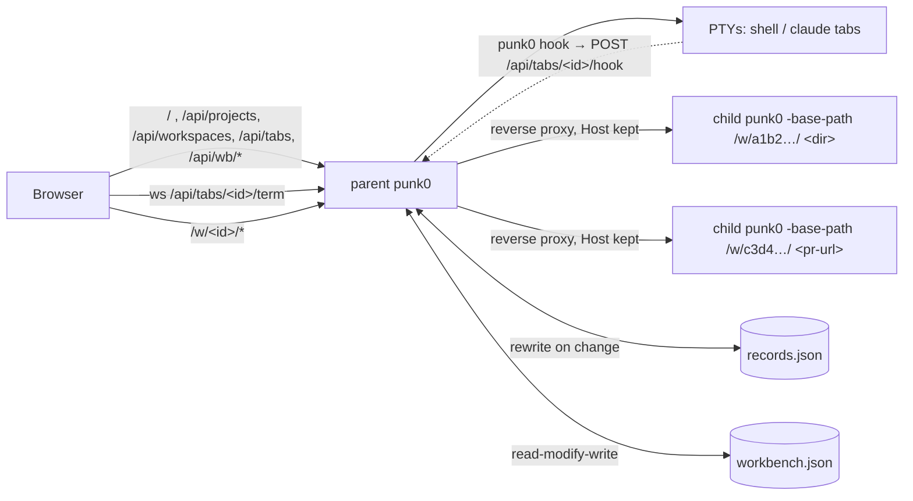

# Orchestrator Internals

The orchestrator (`workbench.go`, `records.go`, `term*.go`, `ring.go`, `hook.go`, `web/workbench.{html,css}`, `web/src/workbench.js`, `web/src/orch/*.js`) is what `punk0` serves for everything except `punk0 <pr-url>`. The parent process owns the agents page, the records (projects, workspaces, tabs) and every terminal. It holds no index and no language servers: every folder or pull request is served by a separate child punk0 behind a reverse proxy.

## Why child processes

`Server` is built around a single workspace: one `Index`, `lspManager`, `agentManager`, `prSession`, `GitWatcher` and `diffBase`, all fixed in `main()`. Rather than threading a workspace ID through every handler, the parent re-runs the punk0 binary per folder. Each child keeps px0's single-folder performance, a crashing or memory-hungry language server only takes down its own child, and stopping a child frees everything it held. Terminals stay in the parent, so stopping a child never kills a shell or an agent.



## Launch and hand-off

`main` sends every non-PR invocation without `-workbench-child` to `runWorkbench`, with `-no-lsp`, `-no-git`, `-no-agent`, `-no-telemetry` and `-agent` collected as the children's flags. `runningWorkbench` checks `workbench.lock`; if a punk0 answers there, `handOff` POSTs the folder to its `/api/projects` (with a matching `Origin`), opens the returned editor URL and exits. A bare second `punk0` just opens the running page. Otherwise `runWorkbench` listens, writes the lock, writes `claude-hooks.json` and the hook base URL (`serveFrom`), registers `punk0 <dir>`'s folder with `Records.Open`, and opens the agents page and that folder's editor. A first instance opens the agents page only when `general.openBrowser` is on (read after the hand-off check, so a hand-off and the editor `punk0 <dir>` asked for still open; `-no-open` wins over both), and starts `autoUpdate` only when `-no-update` is absent and `update.auto` is on.

The page sets `window.name = 'punk0-agents'`; `openEditor` opens editors in `punk0-w-<id>`, and the editor's back link (`web/src/main.js`) targets `punk0-agents`, so each page reuses its own browser tab.

## Records (`records.go`)

`Records` holds `Project → Workspace → Satellite` (tab) and a per-folder `lsp` map, and rewrites `<state>/records.json` on each change. `OpenRecords` refuses a file that does not parse, so a later save cannot overwrite it, and always adds the Scratch project.

- **Projects.** `AddProject` registers a git repository's top level (or a plain folder). A new project starts with one local workspace, plus any worktrees punk0 made for it before it was removed. `newWorkspace` gives every workspace no tabs, so the page opens on its welcome view; a `folder` (scratch chat) gets its agent's tab from `NewChat`. `RemoveProject` puts the project at the front of `removed` in records.json (at most 10, dropped again when re-added); `Removed` lists those whose folders exist, with `len(ownWorktrees)`.
- **Add project (`addproject.go`).** `GET /api/wb/folder?dir=` describes the folder the panel is on (exists, git, top level, branch, registered project id). `GET /api/projects/removed` lists removed projects. `POST /api/projects/new {name, parent}` makes the folder (`os.Mkdir`, refusing anything already there) and runs `git init` only. `POST /api/clones {url, parent}` starts `git clone --progress --filter=blob:none -- <url>` into a hidden `.<name>-clone-*` folder beside the destination, outside every lock, with `runCtxTo` writing git's output into the `cloneJob`, which parses the progress lines; on success it is renamed into place and `Records.Open`ed. `GET /api/clones/{id}` polls it (kept a minute after it ends), `DELETE` cancels it (git's process group is killed, the hidden folder removed). `Close` cancels every clone and waits for them, since git runs in its own process group. A pull request URL is refused with a pointer to the folder field.
- **Git detection.** `gitProbe` remembers a repository per root but "not a repository" only for `gitMissTTL` (3 s), so `git init` in a registered folder shows up without a restart. `handleProjectList` (`restartNewRepos`) remembers each project folder's last `Git`; when it turns true the folder's child is stopped, since a child's `GitWatcher` only starts if the folder was a repository when it started. `POST /api/projects/{id}/refresh` (the row's ⟳) does the same at once: `gitForget` and a stop. `gitBranch` falls back to `symbolic-ref` so a repository with no commits still shows its branch. `Plan` refuses a worktree while `HEAD` is not a commit (`hasCommit`), and `/refs` reports `empty`.
- **Workspace kinds.** `local` shares the project folder; `worktree` owns exactly one worktree at `<state>/worktrees/<project-id>/<folder>`, so deleting it can never pull files from under another, and deleting a dirty one needs `?force=1` (409 `dirty` otherwise); with `workspace.deleteMergedBranch` on, a successful `worktree remove`/`prune` (forced too) is followed by `git branch -d <branch>` outside `Records.mu`, and a refusal (unmerged) comes back as `note` in the `{ok:true, note}` response, never an error; `folder` is a scratch chat, in a folder under `<state>/scratch` that is deleted with it, or in an existing folder of the user's that never is.
- **New workspaces (`newworkspace.go`).** `Records.Plan(projectID, WorkspaceOptions)` (`GET /api/projects/{id}/plan`) decides everything creating would: name, branch (`workspace.branchPrefix` + `branchSlug` of the name, while the folder keeps the unprefixed slug and an existing prefixed branch becomes `existing`; an existing local branch, or a remote-tracking ref, is used as is; a pull request sets it), action (`new` from a base with `--no-track`, `track` a remote branch, `existing`, `local`), base (given, else `defaultBase`: `origin/HEAD`'s target, `origin/main|master`, `main|master`, `HEAD`), the remote to fetch it from (none when `workspace.fetchBase` is off), and the folder (`folderName`, `-2`… on collision). It refuses a branch checked out in another worktree (`checkedOutAt`). `AddWorkspace` runs the same plan, reserves name and folder in `Records.creating` under `mu`, runs `fetchBranch` (30 s, `runCtx` kills git's process group) and `git worktree add` without the lock, then records the workspace with its first tab (`Agent`) and `LSP`. `findProjectPull` turns `#N` (via the remote's forge and `prWebURL`) or a PR URL into the PR; `workOn` fetches its head branch, or a fork's forge head ref into `refs/punk0/pr/N`. `GET /api/projects/{id}/refs` lists branches for the panel.
- **Scratch chats (`scratch.go`).** `NewChat(ChatOptions)` (`POST /api/chats`: title, group, agent, dir) runs the chat in a folder directly inside `<state>/scratch` that it makes with `os.Mkdir` and refuses if it exists, so a chat never takes over another chat's folder; with no dir it claims `chat-MMDD-HHMM` (then `-2`, `-3`…). Any other dir is the user's: `MkdirAll`ed and never deleted. Whether a folder is punk0's is decided with symlinks resolved (`inside`, `resolvePath`), and a scratch folder is stored in the scratch folder's own spelling, which is what `RemoveWorkspace` checks before deleting. `AddWorkspace` refuses the Scratch project. A chat's `Name` is its folder's name and never changes, since agents key a session's history on the working directory; the page shows `Title`, from the New chat flyout or, while empty, set by `ChatPrompt` from the first `UserPromptSubmit` hook (`chatTitle`: first line, slash commands skipped, cut at a word before 60 characters). `ChatPrompt` also sets `Active` (unix ms, the list's sort key). `UpdateChat` (`PATCH /api/chats/{id}`) sets `Title`, `Group`, `Pinned` or `Archived`; archiving closes the tabs and `handleChatUpdate` stops the folder's child. Groups are `Project.Groups` on Scratch (`/api/chat-groups`); a chat holds a group id, and `RemoveChatGroup` clears it from every chat. `List` and `View` copy each project and workspace under the lock, so a rename cannot race the JSON encoder. The New chat flyout (`newchat.js`) is fixed just right of `#o-side`, level with the button that opened it, whose position it keeps since the list re-renders beneath it; its folder browser lists folders with `/api/wb/complete?all=1`, which lifts the 50-entry cap typing completion has.
- **Tabs.** `shell` or an agent from `tabAgents` (`tabagents.go`): `claude`, `codex`, `opencode`, `agy`, `cursor-agent`. `agentCommand` builds the line the tab's shell runs: on its first start this run (`newChat`) a new session, later a resume: Claude by session id, Codex `resume --last` (which filters sessions to the working directory) and OpenCode `--continue` (its last session), the others a new session. `agents.<id>.args` goes verbatim right after the program name on every start (`claude <args> --settings …`, `codex <args> resume --last || codex <args>`). A new tab never resumes, since in a folder of the user's the latest session may belong to something else. `GET /api/agents` lists the agents with whether each is installed (`harness.LookPath`), resumes and reports status. Running shells are never saved: after a restart every tab is stopped and starts again on attach.
- **Folder IDs.** A folder's child is keyed `wbItemID("dir", ws.Dir)`, so local workspaces of one project share a child. `Records.Folder(id)` resolves a `/w/<id>/` back to its folder.

## Terminals (`term.go`, `term_unix.go`, `term_windows.go`, `ring.go`)

`Satellite.Shell` starts the tab's shell in a PTY on first attach (`startShell`), in the workspace folder, running `terminal.shell` (else `$SHELL`, else `/bin/sh`), with `terminal.env` (`parseEnvLines`; ignored if it does not parse) added after the inherited environment and before punk0's own variables such as `PUNK0_HOOK_URL`, so those always win. A claude tab runs `claude --settings <state>/claude-hooks.json --resume <uuid> || … --session-id <uuid>`, or only `--session-id` for a chat made this run, so the chat resumes across restarts.

- **Transport.** `GET /api/tabs/{id}/term` upgrades to a websocket: binary frames carry bytes both ways, text frames carry `{"cols","rows"}`. Frames may be up to 8 MiB.
- **Scrollback.** Each shell keeps its last 256 KiB in a `ring`; `Attach` replays it and then streams live output, with nothing lost or repeated between the two. A viewer more than 256 reads behind is disconnected (`StatusTryAgainLater`) and reattaches from scrollback.
- **Lifetime.** Shells outlive websockets. `Shell.Close` hangs up the process group (SIGHUP on Unix). `workbench.Close` stops the terminals first, then every child in parallel.
- **Loopback only.** `handleTerm` returns 403 unless the parent listens on loopback (`localOnly`).

## Hooks (`hook.go`)

`writeClaudeHooks` writes `<state>/claude-hooks.json`, registering `<this punk0> hook` for `SessionStart`, `UserPromptSubmit`, `PreToolUse`, `PostToolUse`, `PostToolUseFailure`, `PermissionRequest`, `Notification`, `Stop`, `StopFailure` and `SessionEnd`. `punk0 hook` (`runHook`) posts the event from stdin to `PUNK0_HOOK_URL` (`<loopback base>api/tabs/<id>/hook`) and stays silent, since hook output would show up in the agent's chat. `handleHook` goes through the same `Origin` check as other changes. `hookStatus` maps events to `working` (prompt, tool use, or a stop with background tasks still running), `waiting` (permission request, permission or elicitation notification), `idle` (session start, stop, idle notification) or none (session end).

## Children

`workbench.start` runs:

```
punk0 [passed-on flags] -workbench-host <host> -workbench-child -host 127.0.0.1 -port 0 -no-open -no-update -no-color -base-path <base>w/<id>/ [-no-lsp] <dir | pr-url>
```

- **Language servers.** A folder child gets `-no-lsp` unless `Records.LSPOn(dir)`; a parent started with `-no-lsp` already passes it to all. `POST /api/workspaces/{id}/lsp` stores the choice and stops the folder's child, since the flag is read only when a child starts; the next request starts one that matches. The page's status bar item (`web/src/orch/lsp.js`, px0's `#st-lsp` / `#lsp-menu` styles) toggles it and, while the child runs, lists and starts / stops its servers through the child's own `/api/lsp/servers`, `/start` and `/stop`.
- **Readiness.** With `-workbench-child`, `main` prints `px0-ready <addr>` once it is listening. The parent reads child output through `lineWriter`, which also drops spinner frames (`\r`), and keeps the last 20 lines; `wbChild.failure` reports the last `punk0: …` line as the error.
- **Lifetime.** The parent holds the child's stdin. The child treats EOF on stdin as SIGTERM and shuts down the normal way, which removes PR worktrees and stops language servers. This works if the parent is stopped, crashes or is killed, on every platform. `stop` closes stdin and kills the child after 5 seconds. `cmd.WaitDelay` keeps a grandchild holding the output pipes from blocking `Wait`.
- **States.** `starting` → `running` → `stopped`, or `failed` if the child exits before it is ready or takes longer than `wbStartTimeout` (3 minutes; a PR may clone a large repository). Live state is kept only in memory.
- **PR clones.** `checkoutPR` makes a worktree when its working directory is a clone of the PR's repository, so the parent starts every PR child in one (see below). Before the child is launched, `run` resolves the clone, or makes one, while the state is `starting` and `progress` says what it is waiting on. `stop` cancels this through `wbChild.ctx`.

## Idle stop

`reapIdle` ticks every minute and re-reads settings each time, so a change applies without a restart; `idleLimit` treats `0` as never.

- **Children.** The proxy counts requests in flight per child and records when the last one ended. A running child with none in flight for `workspace.idleStop` minutes (default 5) is stopped.
- **Terminals.** A tab whose PTY has carried nothing for `terminal.idleStop` minutes (default 30) is closed if `stopIdleTab` allows it: a shell only when the PTY's foreground process group is the shell itself (`TIOCGPGRP`; never on Windows), a claude tab only when its hook status is `idle`.

## PR clones ([`workbench.go`](../../workbench.go))

Every PR is a worktree of one local clone per repository; nothing is cloned per PR.

- **Matching.** `findPRRemote(dir, owner, repo)` (pr.go) returns the clone's top level and the name of the remote that points at the repository. It checks `origin` first, then `upstream` (a fork), then any other remote. `remoteMatchesRepo` compares the parsed `owner/repo` of https, ssh and scp-style URLs exactly, ignoring case. `checkoutPR`, `computeDiffBase` and `Pull` fetch from that remote rather than assuming `origin`. An empty remote name still means `origin`.
- **Finding.** `findClone` tries `knownClone` first: the clone remembered in `workbench.json` (`clones`, keyed by lowercased `owner/repo`), then the registered project folders (`Records.ProjectDirs`), then the parent's cwd. Failing that, `scanForClone` searches the usual code folders under home, the parents of the project folders and around the cwd, breadth-first, three levels deep. It skips hidden and dependency folders, looks at no more than 20,000 entries and gives up after 1.5 seconds, and it only considers folders named like the repository that hold a `.git`. A clone found this way is remembered.
- **Asking.** `/api/wb/open` checks for a clone before it records a PR. With none, it returns `{needClone, repo, managed}` and the sidebar asks. The next request passes `clone`, either a folder (verified with `cloneOf`, then remembered) or `"managed"`.
- **punk0's own clone.** `makeClone` clones once into `<state>/repos/<owner>/<repo>`, as a partial clone (`--filter=blob:none`) with no checkout of its own. It clones into a sibling temp folder and renames it into place, so an interrupted clone never looks finished. A per-repository mutex keeps two PRs opened together from cloning twice.
- **Credentials.** `gitLocalThenToken` runs the head fetch and `worktree add` with the clone's own git credentials first, and with the forge token only if that fails. A partial clone fetches file contents during `worktree add`, which a private repository's token covers.
- **Reopening.** A PR whose clone has disappeared fails with `errNoClone`. The holding page then offers **Choose a clone**, which links to the agents page with `?open=<url>`.
- **CLI.** `main` passes `knownClone`'s result (the remembered clone and the project folders read from `records.json` by `recordedProjectDirs`, no scan) to `checkoutPR` when `punk0 <pr-url>` runs outside a matching clone.

## Proxy

`/w/<id>/…` goes to the child's `httputil.ReverseProxy`, which has `FlushInterval: -1` so event streams are not buffered. The proxy keeps the browser's `Host` header, so the child's `localPost` check, which compares `Host` with `Origin`, still passes. The child serves under its own base path, and its `/api/meta` reports `workbench`, the parent's base path. The editor uses it for the back link and to send **Git: Open Pull Request…** to `/api/wb/open` instead of `/api/pr/launch`.

Any request for a known folder or PR starts its child. A GET of the editor page itself (`/w/<id>/`) returns a holding page that refreshes every second until the child is ready, or shows the error with **Retry**. Other requests (the agents page's tree, file and finder calls) wait up to `wbAPIWait` (30 seconds) for the child, then get 503. An unknown ID is 404.

## Page

`web/workbench.html` is driven by `web/src/workbench.js`, a second bundle entry in `scripts/build-web.js` (output `web/workbench.js`, gitignored like `app.js`). It uses the modules under `web/src/orch/`: `store.js` (state from `/api/projects` and `/api/wb/state`, selection: per workspace the last terminal tab, last file tab and which was used last, saved under `punk0.tabs`; `activeTab()` is the one in front, `termTab()` / `fileTab()` each group's; the file group's tabs are the open files (`punk0.files`; `diff: true` for those shown as their diff, `punk0.fileDiff`, set by `openFile(path, 'diff' | 'source')`) behind the Changes tab (`CHANGES_TAB`, `changes: true`, no path; open per workspace under `punk0.changes`); `state.collapsed`, saved under `punk0.splitCollapsed`, is the split group collapsed, cleared by selecting a tab of that group or closing the file group's last tab), `sidebar.js` (the Projects and Scratch views, the per-view search, group names edited in place, the add form and the clone question; view saved under `punk0.sideView`, folded projects under `punk0.collapsed`), `listview.js` (View options: grouping, sorting, the Show and Filters choices and their count, saved per view under `punk0.listView`, plus the row predicates `isRunning`, `stateOf` and `agentOf` the views group by), `newchat.js` (the New chat flyout), `complete.js` (folder completion from `/api/wb/complete`), `split.js` (the center's layout: `layout.fileView` and the room the two groups share beside the files pane (`GROUP_MIN` 320 px per group) decide split or tabs; `view()` says which terminal tab, file tab and welcome view are shown, `layoutCenter()` puts that into `#o-center`'s classes (`split`, `files-open`, `term-off`, `file-off`, `file-shown`), and the split border keeps the terminal group's share as `--o-split`, saved under `punk0.split`, with VS Code's snap: past half of `GROUP_MIN` a drag collapses that group and restores the pre-drag share; the ◫ `.o-side-toggle` buttons and Ctrl+Alt+B close the open files and the files pane together, or open whatever of them is closed, through `resize.js`'s `setHidden` and `state.collapsed`, with `aria-pressed` while both show, kept current on `resize.js`'s `pane:toggled`). `#o-center` is a CSS grid of three rows (tab bars; the path row and the files pane's head; bodies) and five columns (terminal group, split border, file group, files pane border, `#o-files`), so the rightmost tab bar runs over the files pane and the second row runs the full width; `#o-viewer` is `display: contents` so its path row and code take grid cells of their own; `.o-open-editor` and `.o-side-toggle` sit in both tab bars and show only in the rightmost. Then `tabs.js` (the terminals' and the file group's tab bars), `term.js` (xterm.js from `web/vendor/xterm*` over the terminal websocket), `tree.js`, `viewer.js` and `picker.js` (file tree, read-only viewer and file finder through the folder's child: `w/<id>/api/tree`, `api/file`, `api/find`; in a git checkout (`hasGit`) `tree.js` shows only changed files by default, `#o-tree.changed-only` hiding clean rows by the backend's `dirty` flags and `expandDirty` opening changed folders, with the `#o-tree-mode` switch saved under `punk0.treeMode`, and a click there opens the file as its diff; it keeps current through the child's `api/stream` `git-status` events, redrawing (`refreshTree`, single-flight) when the statuses change, with the stream open only while the page is visible and the files pane shown, since an open request holds off the child's idle stop; `viewer.js` also owns the status bar's `#st-file` group, filled from the first `api/file` chunk's `total`, `eol`, `encoding`, `added` and `deleted`, its per-file cursor and the `#o-goto` Go to line box, and `workbench.js` calls `hideFile()` when no file is shown; a terminal out of view stays attached, but one is only attached once shown, since attaching starts a stopped tab), `changes.js` (diffs drawn into `#o-diff-vp`, which takes `#o-code-vp`'s grid cell, with the editor's hunk tables from `web/src/difftable.js`: the Changes tab, opened by the files pane's Diff button, is `w/<id>/api/changes` file after file under folding headers; a file tab with `diff` set is `api/changes?path=` alone, without a header, its path row's `#o-file-mode` switch flipping the tab between text and diff; one column unless the files are maximized (`state.collapsed === 'term'`), then the path row's switch picks split or unified, saved under `punk0.diffLayout`, split first; a diff reloads each time it comes into view), `statusbar.js` (the status bar, its needs-you / working buttons counted from the store's tab statuses, and the `#helpsheet` shortcuts sheet, styled by the editor's `.help-card` rules in `style.css`), `resources.js` (the resource panel), `resize.js` (side panes: widths as `--wb-left`/`--wb-right` on `#wb-app`, written once per animation frame, hidden panes as its `hide-left`/`hide-right` classes, all saved under `punk0.layout`; Ctrl+B for the projects pane; `body.wb-resizing`, also set by `split.js`, makes `term.js` defer its PTY refit until a drag rests) and `api.js`. It shares `state.js`, `theme.js`, `metricsview.js` (`fmtBytes`) and `difftable.js` with the editor. The page never writes settings: the parent renders `workbench.colorTheme` into it (`wbTheme`), and a theme picked in an editor of this browser wins through `chooseThemePreference`. The list re-renders whenever polled state changes, so `renderSidebar` carries a name being typed (and its selection) over to the new input, and double-click actions read the second click's `detail` instead of `dblclick`, which a re-render between the clicks loses.

`/api/changes` (`changes.go`, served by each folder's child) returns `{git, files, truncated}`: `git diff -M --relative <diffBase>` cut into one `ChangedFile` per file (`path`, `from` for a rename, `status` A/M/D/R, or U for an untracked file, which is read and shown as one all-added hunk; `add`, `del`, `binary`, `large` and the `highlightDiff` hunks). A file past `changeFileMax` (256 KiB of diff) comes without hunks, and past `changesMax` (500) files the list is cut and `truncated` set. `?path=` keeps one file: the whole tree is still diffed, so a rename keeps its `from`, but only the matching chunk is highlighted (`diffFileHead`, then `diffFileBody`); an unchanged file comes back as no files, and a path outside the folder is a 400.

`/api/resources` (`wbresources.go`) measures process trees from one snapshot of the process table (`internal/metrics.Processes`: `/proc` on Linux, `ps` elsewhere, nothing on Windows, where only the parent is reported). Each running tab is its shell's tree, so an agent and whatever it starts count against its tab; each workspace's editor tree is split in two, `editor` (its child's own process) and `lsp` (everything below it: its language servers, plus a git command now and then, rarely caught by a poll); a running child no workspace claims is a review. `self` is the parent's tree minus every claimed tree, so the rows add up to the total. CPU percentages (100% = one core) come from `cpuMeter`, which compares each row's cumulative CPU time with the previous request's; requests less than 500ms apart reuse the last figures. The response carries ids and figures only; the page names rows from its store and keeps the sparkline history itself.

`resources.js` shows `editor` and `lsp` as separate rows under each workspace, and emits every reply as `resources` on the bus; `lsp.js` adds up `lsp.rss` over the folders whose servers are on for the status bar item and its All folders list. Reading the process table goes through no child, so unlike a proxied request it does not count as using an editor and never holds off the idle stop (`serveProxy` marks every proxied request as activity).

## Item IDs

`wbItemID` is the first 6 bytes, as hex, of the SHA-256 of the kind plus a key: the cleaned absolute path for a directory, or the lowercased `provider/owner/repo#n` for a pull request. The ID is stable, so `/w/<id>/` is stable. A PR's review drafts are saved in a session file named after the same ID (`prSessionFilePath`), so they survive a reopen, from the agents page or from `punk0 <pr-url>`, even though each opening checks the PR out into a new temporary directory.

## Store

`workbench.json` holds only the Reviews list (PR items, the 50 most recent) and the remembered clones; folders live in `records.json`, and `load` drops any directory items an older file still has. `wbStore` keeps nothing in memory. Each change re-reads the file, applies the change and writes it back atomically (temp file + rename). A plain `punk0 <pr-url>` records itself through `recordRecent`, so the parent must not overwrite entries it never loaded. An unparseable file is renamed to `workbench.json.bad` rather than overwritten.

A PR added by `/api/wb/open` that fails before its child is ready is removed again (`forget`), so a mistyped URL does not stay in the list. The holding page still shows the error from the in-memory child.

## Single instance

`workbench.lock`, next to `workbench.json`, records the parent's PID and loopback URL. A second punk0 pings `/api/wb/ping` there and hands off to it if it answers (see above). Only the process that wrote the lock removes it.

## Security

`/api/wb/complete` lists folders anywhere on disk, and `/api/projects` and `/api/wb/open` can start a child on any of them. Requests that change anything go through `localPost` or `localOrigin`: a `Host` that is an IP address or localhost, and an `Origin` that matches it. GET requests for state and folder listings, and the editor page, go through `trustedGet`, which applies the same `Host` check against DNS rebinding. Terminals are served only while the parent listens on loopback. Children bind only to 127.0.0.1 and can be reached only through the proxy. When bound to a non-loopback address, punk0 prints a warning that anyone who can reach it can browse the machine.
