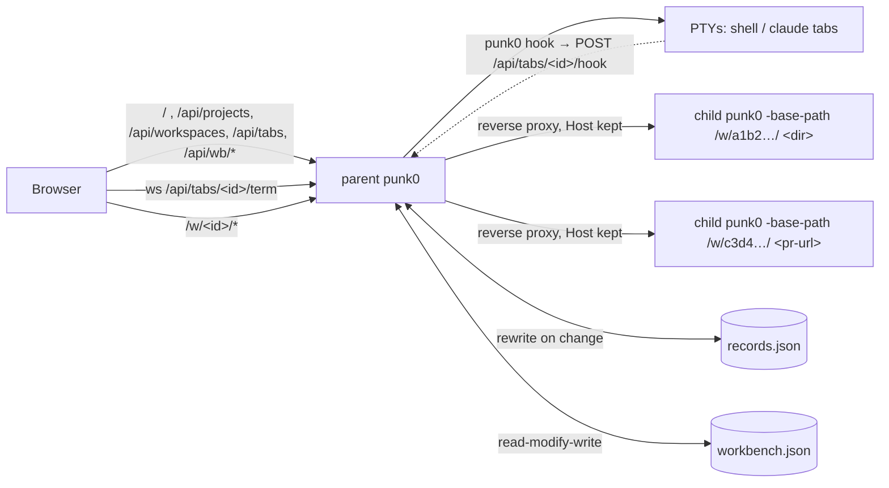

# Orchestrator Internals

The orchestrator (`workbench.go`, `records.go`, `term*.go`, `ring.go`, `hook.go`, `web/workbench.{html,css}`, `web/src/workbench.js`, `web/src/orch/*.js`) is what `punk0` serves for everything except `punk0 <pr-url>`. The parent process owns the agents page, the records (projects, workspaces, tabs) and every terminal. It holds no index and no language servers: every folder or pull request is served by a separate child punk0 behind a reverse proxy.

## Why child processes

`Server` is built around a single workspace: one `Index`, `lspManager`, `agentManager`, `prSession`, `GitWatcher` and `diffBase`, all fixed in `main()`. Rather than threading a workspace ID through every handler, the parent re-runs the punk0 binary per folder. Each child keeps punk0's single-folder performance, a crashing or memory-hungry language server only takes down its own child, and stopping a child frees everything it held. Terminals stay in the parent, so stopping a child never kills a shell or an agent.



## Launch and hand-off

`main` sends every non-PR invocation without `-workbench-child` to `runWorkbench`, with `-no-lsp`, `-no-git`, `-no-agent`, `-no-telemetry` and `-agent` collected as the children's flags. `runningWorkbench` checks `workbench.lock`; if a punk0 answers there, `handOff` POSTs the folder to its `/api/projects` (with a matching `Origin`, `postWorkbench`), then POSTs the returned workspace id to `/api/wb/show`. That sends a `select` event to every agents page listening on `GET /api/wb/events` (`pageHub`, `wbpages.go`) and answers how many there are; with none (or an older punk0 that answers 404) `handOff` opens the agents page at `?ws=<id>` (`agentsURL`). A file also opens its editor URL. A bare second `punk0` just opens the running page. Otherwise `runWorkbench` listens, writes the lock, writes `claude-hooks.json` and the hook base URL (`serveFrom`), registers `punk0 <dir>`'s folder with `Records.Open`, and opens the agents page at `?ws=<id>`, plus the folder's editor only for a file. A bare start opens the agents page only when `general.openBrowser` is on (read after the hand-off check, so a hand-off and whatever `punk0 <target>` asked for still open; `-no-open` wins over both, but a hand-off still switches open pages), and starts `autoUpdate` only when `-no-update` is absent and `update.auto` is on.

On load the page selects `?ws=<id>` when present, saves it as `punk0.ws` and drops the parameter with `history.replaceState` (`initialWs`, `web/src/orch/store.js`); otherwise it restores `punk0.ws`. A `select` event reloads the list, since the folder was just registered, then selects the workspace (`web/src/workbench.js`). `Close` ends the event streams first so they do not hold up `Shutdown`.

Terminal output after the startup block is `ui.Event` lines (`HH:MM  glyph what where  note`). Names come from `Records.TabLabel` and `Records.WorkspaceLabel` (`workspaceLabel`: "project / workspace", the project alone when its folder's workspace has the same name, a scratch chat's title). `handleTerm` prints `▶` when `Satellite.Shell` reports it started a shell, and waits on `Shell.exitedByItself` to print `■ … exited`; `Shell.Close` sets `closed`, so stops by punk0 (idle, tab removed, shutdown) print nothing there. `reapTabs` and `reapChildren` print their own `■ … idle N min`, and `handlePageShow` prints `+ opened`. The printed agents URL omits `?ws=` unless no browser opens. `ui.NoEcho` clears `ECHO` on stdin's terminal (`ENABLE_ECHO_INPUT` on a Windows console) after the startup block; `runWorkbench` restores it on return and before every `os.Exit` and `fatal`. Signals are untouched, so Ctrl-C still works; a punk0 killed with SIGKILL leaves echo off until `stty sane` or the shell resets it.

The page sets `window.name = 'punk0-agents'`; `openEditor` opens editors in `punk0-w-<id>`, and the editor's back link (`web/src/main.js`) targets `punk0-agents`, so each page reuses its own browser tab.

## Folders (`internal/paths`, `migrate.go`)

One package decides where punk0's files go: `paths.Config()` (settings.json), `paths.State()` (records.json, workbench.json, logs, sessions, hooks, lock, repos, trash) and `paths.Cache()` (the Mermaid download). Unix follows the XDG base directories, macOS included; Windows uses `%APPDATA%\punk0` and `%LOCALAPPDATA%\punk0\state|cache`, the state kept out of the folder `install.ps1` puts `punk0.exe` in. `Config` and `State` fall back to the legacy `~/.punk0` while only that folder has their marker file (`settings.json`, `records.json`), each deciding on its own, so an upgrade moves nothing; a set, absolute `XDG_*` variable always wins, since those were honoured before this layout too. `workbenchStateDir`, `settings.Path`, `update.stateFilePath`, `sessionDir` and `vendorCacheDir` are the only callers.

`punk0 migrate` (`migrate.go`, dispatched in `main.go` beside `hook`) moves settings to the config folder and `workbench.json`, `update_check.json`, `anonymous_id`, `logs/` and `sessions/` to the state folder, **`records.json` last**: it is the marker, so a failure part-way leaves punk0 on the legacy folder with everything it needs. `claude-hooks.json` is deleted (rewritten on every start) and so is the legacy `cache/` (refetchable). Worktrees, scratch chats, `repos/` and `trash/` stay where they are, since records.json holds their absolute paths. It refuses while `runningWorkbench()` answers, and `moveAll` falls back to copy + remove when a rename cannot cross filesystems. `handleState` reports `folders: {config, state, legacy}` so the help sheet can offer the move, and `/api/diagnostics` names both folders.

## Records (`records.go`)

`Records` holds `Project → Workspace → Satellite` (tab) and a per-folder `lsp` map, and rewrites `<state>/records.json` on each change. `OpenRecords` refuses a file that does not parse, so a later save cannot overwrite it, and always adds the Scratch project.

- **Projects.** `AddProject` registers a git repository's top level (or a plain folder). A new project starts with one local workspace, plus any worktrees punk0 made for it before it was removed (`ownWorktrees`: those `ownWorktree` recognises, in the Workspaces Folder or an older install's `<state>/worktrees`). Every worktree listing goes through `listWorktrees`, which parses `git worktree list --porcelain` line by line (not `-z`, which needs git 2.36, so a newline in a folder name is the one thing it cannot read). Folders are compared with `sameDir` (cleaned, then with symlinks resolved); `worktreeAt` and `linkedWorktree` use it. `newWorkspace` gives every workspace no tabs, so the page opens on its welcome view; a `folder` (scratch chat) gets its agent's tab from `NewChat`. `Project.Owned` is set by `SetOwned`, which only `POST /api/projects/new` and a finished clone call, and travels through `removed` so a re-added project is owned again; it is what lets a removal delete the folder. `RemoveProject(id, RemoveOptions)` without `Files` puts the project at the front of `removed` in records.json (at most 10, dropped again when re-added); `Removed` lists those whose folders exist, with `len(ownWorktrees)`. With `Files` (`trashableLocked`: `Owned`, `Confirm` equal to the project name, no linked worktree left, no other registered project or workspace folder inside it) the folder is moved to `<state>/trash` by `moveToTrash` instead, EXDEV coming back as "delete it yourself", and the project is not recorded under `removed` at all, since it could never be added back. The agents' transcripts are never touched by either removal: Chats mode owns them (history.go).
- **Add project (`addproject.go`).** `GET /api/wb/folder?dir=` describes the folder the panel is on (exists, git, top level, branch, registered project id). `GET /api/projects/removed` lists removed projects. `POST /api/projects/new {name, parent}` makes the folder (`os.Mkdir`, refusing anything already there) and runs `git init` only. `POST /api/clones {url, parent}` starts `git clone --progress --filter=blob:none -- <url>` into a hidden `.<name>-clone-*` folder beside the destination, outside every lock, with `runCtxTo` writing git's output into the `cloneJob`, which parses the progress lines; on success it is renamed into place and `Records.Open`ed. `GET /api/clones/{id}` polls it (kept a minute after it ends), `DELETE` cancels it (git's process group is killed, the hidden folder removed). `Close` cancels every clone and waits for them, since git runs in its own process group. A pull request URL is refused with a pointer to the folder field.
- **Git detection.** `gitProbe` remembers a repository per root but "not a repository" only for `gitMissTTL` (3 s), so `git init` in a registered folder shows up without a restart. `handleProjectList` (`restartNewRepos`) remembers each project folder's last `Git`; when it turns true the folder's child is stopped, since a child's `GitWatcher` only starts if the folder was a repository when it started. `POST /api/projects/{id}/refresh` (the row's ⟳) does the same at once: `gitForget` and a stop. `gitBranch` falls back to `symbolic-ref` so a repository with no commits still shows its branch. `Plan` refuses a worktree while `HEAD` is not a commit (`hasCommit`), and `/refs` reports `empty`.
- **Workspace kinds.** `local` shares the project folder; `worktree` owns exactly one worktree, at `<code root>/workspaces/<project-id>/<folder>` when punk0 made it and wherever it already was when punk0 adopted it (`Workspace.Adopted`); `folder` is a scratch chat, in a folder under `<code root>/scratch` that is deleted with it (`Workspace.Owned`), or in an existing folder of the user's that never is. The code root is the `workspace.dir` setting, resolved by `codeRootPath` (pure) and `codeRoot` (creates it, refuses a git repository); `ownWorktree(dir, root)` decides whether a folder is one of punk0's. `RemoveWorkspace(id, RemoveOptions)` takes the dialog's answers: without `Files` it only forgets the workspace, so the folder, its branch and the repository's worktree registration survive and adding the project again finds it; with `Files` a worktree is removed by `git worktree remove` (never `os.RemoveAll`), after `linkedWorktree` has found the folder in `listWorktrees(p.Dir)` and seen it is neither the main checkout nor prunable — the refusals all run before a single tab is stopped, and a missing folder is pruned instead. A dirty worktree needs `?force=1` (409 `dirty` otherwise). With `workspace.deleteMergedBranch` on, a successful `worktree remove`/`prune` (forced too) is followed by `git branch -d <branch>` outside `Records.mu`, and a refusal (unmerged) comes back as `note` in the `{ok:true, note}` response, never an error. The chats that ran in the folder stay on disk and keep being listed; with no workspace left there they fall into All scope's Other folders.
- **New workspaces (`newworkspace.go`).** `WorkspaceOptions` on the wire (`POST /api/projects/{id}/workspaces` JSON, `GET /api/projects/{id}/plan` query): `name` is only the label; `from` is what the workspace is made from (branch, remote branch, tag, commit, `#N` or PR URL, or an absolute / `~/` worktree folder; `""` = the project folder's HEAD); `branch` is a typed new branch name (`""` = none); `worktree` (query `worktree=1`); `agent`, `lsp`. `Base` is internal (`json:"-"`): the start point `workOn` writes for a pull request, overriding `From`; so is `Parent` (Nesting, below). There is no default remote base: an empty `from` is the project folder's HEAD. `Records.Plan(projectID, WorkspaceOptions)` decides everything creating would, in this order: (1) no `worktree`: `local` in the project folder; `from` must be `""` or the current branch, and a name is required ("Type a name"); (2) a folder in `from`: the worktree there (`worktreeAt`; any other path is refused), via `planWorktree`; (3) start point `S` = `Base`, else `From`, else `HEAD`; a leading `-` is refused, and `S` must pass `rev-parse --verify S^{commit}` ("unknown branch or commit"); (4) the branch: `branch` verbatim (no prefix; `check-ref-format`), else for a `from` that is empty, the current branch, a tag or a commit `workspace.branchPrefix` + `branchSlug(name)` with the folder from the unprefixed slug ("Type a name or a branch name" without a name), else `from` itself when it is a local branch, else the local branch for a remote-tracking `from`, tracking it; (5) a branch checked out in a worktree (`checkedOutAt` over `listWorktrees`) goes to `planWorktree`; (6) action: `existing` when the branch exists locally, `track` the remote-tracking `from` of (4), `track` `S` when `S` is the branch's remote-tracking ref, `track origin/<branch>` when that exists (so a remote branch is not shadowed by a new one), else `new` from `S` with `--no-track`; (7) an empty name defaults to the branch (in 2 and 5 to the worktree's branch, else its folder's base name), with `-2`, `-3`… on collision, while a typed name that collides is refused. `startIgnored` in the plan says the start point asked for was not used: an `existing` branch reached through `branch` or the slug, or the `origin/<branch>` case. The plan also carries the remote to fetch `Base` from (none when `workspace.fetchBase` is off) and the folder, `<code root>/workspaces/<project-id>/<folderName(branch)>` (`-2`… on collision), where `codeRoot()` creates the code root and refuses a git repository, its error becoming the plan's. `planWorktree` answers `open`, with `workspace` set to the id of the workspace running there (in any project, `workspaceDirsLocked`), when one does, even when the folder was deleted (that row's ✕ prunes). Otherwise it refuses with `prune: true` when git marks the worktree prunable, refuses the project folder itself ("choose it as Branch to work there") and the repository's main checkout, and else answers `adopt`. A pull request in `from` is looked up by `handleWorkspaceAdd` / `handleWorkspacePlan` with `findProjectPull`; `projectPull.options` sets `Name` to `#N Title` only when it is empty, `Branch` to the head branch or `pr-N` only when it is empty, and `From` to `""`, and `handleWorkspacePlan` keeps `adopt`/`open` (with `pr` attached) instead of `pr`. `AddWorkspace` runs the same plan, reserves name and folder in `Records.creating` under `mu`, runs `fetchBranch` (30 s, `runCtx` kills git's process group) and `git worktree add` without the lock, then records the workspace with its first tab (`Agent`) and `LSP`. `open` returns the workspace that runs there, untouched (no tab, no LSP change). `adopt` reserves name and folder like the others but runs no git, and records `Workspace{Kind: worktree, Dir, Branch, Adopted}`. `Adopted` is false for a folder `ownWorktree` recognises (the code root's `workspaces/`, or an old install's `<state>/worktrees`), which is punk0's however it comes back. `AdoptWorktree(projectID, dir)` is `AddWorkspace` with `From: dir`, for callers that hold a folder; attribution and the panel's adopt-by-folder pass the folder in `From` too. `findProjectPull` turns `#N` (via the remote's forge and `prWebURL`) or a PR URL into the PR; `workOn` fetches its head branch, or a fork's forge head ref into `refs/punk0/pr/N`, and sets `Base` to it. `GET /api/projects/{id}/refs` answers `{current, head, empty, refs, worktrees}`: `current` is the project folder's branch (`""` when detached), `head` its short commit (`""` with no commits), `refs` the branches (`gitRefs`), and `worktrees` is `Records.Worktrees`, every worktree but the main checkout and the project folder as a `worktreeInfo` (`path`, `branch`, `head`, `detached`, `locked`, `prunable`, `main`, and the id of the `workspace` running in it, in any project; git runs outside `mu`), to which `handleRefs` appends the main checkout (`main: true`) when it is not the project folder. Outside git it is `{current: "", head: "", empty: false, refs: [], worktrees: []}`. `POST /api/projects/{id}/prune` (`PruneWorktrees`) runs `git worktree prune`, so a branch whose worktree folder was deleted can be checked out again; workspaces on such folders stay, listed as missing.
- **Nesting.** `Workspace.Parent` (`parent`) is the workspace of the same project a worktree workspace is listed under (the one whose agent made it), any depth; only `worktree` workspaces have one, and it is only set on create, by attribution: `WorkspaceOptions.Parent` is internal (`json:"-"`). `RemoveWorkspace` re-parents the removed workspace's children to its own parent and re-points its chats' membership there (`refileLocked`), or forgets them when it had none. A worktree adopted by folder (`from`) with no `name` is named after its branch (else its folder), with `-2`, `-3`… when the project already has that name. `RenameWorkspace(id, name)` (`PATCH /api/workspaces/{id} {name}`, `handleWorkspaceUpdate`; the sidebar's ⋯ **Rename…**) changes only the label: `label(name, 80)`, unique in the project (400 otherwise), 404 for an unknown id. The sidebar lists no worktree without a workspace: the New workspace panel's `GET /api/projects/{id}/refs` `worktrees` offers them for adopting.
- **Tabs at a folder.** `TabsAt(id)` (`GET /api/workspaces/{id}/tabs`) takes a workspace id or a folder backend id; for a folder it returns the tabs of every workspace at that folder, in records order. Each `tabView` carries `workspace` and `workspaceName`.
- **Scratch chats (`scratch.go`).** `NewChat(ChatOptions)` (`POST /api/chats`: title, group, agent, dir) runs the chat in a folder directly inside `<code root>/scratch` that it makes with `os.Mkdir` and refuses if it exists, so a chat never takes over another chat's folder; with no dir it claims `chat-MMDD-HHMM` (then `-2`, `-3`…). Any other dir is the user's: `MkdirAll`ed and never deleted. `NewChat` points the Scratch project's `Dir` at the current code root first, so a changed setting applies without a restart; `OpenRecords` marks the chats that sat under the scratch folder **as recorded** `Owned` before moving it (`placeScratchLocked`), so chats made before the move still go with their chat. Whether a folder is punk0's is decided with symlinks resolved (`inside`, `resolvePath`), and a scratch folder is stored in the scratch folder's own spelling. `AddWorkspace` refuses the Scratch project. A chat's `Name` is its folder's name and never changes, since agents key a session's history on the working directory; the page shows `Title`, from the New chat flyout or, while empty, set by `ChatPrompt` from the first `UserPromptSubmit` hook (`chatTitle`: first line, slash commands skipped, cut at a word before 60 characters). `ChatPrompt` also sets `Active` (unix ms, the list's sort key). `UpdateChat` (`PATCH /api/chats/{id}`) sets `Title`, `Group`, `Pinned` or `Archived`; archiving closes the tabs and `handleChatUpdate` stops the folder's child. Groups are `Project.Groups` on Scratch (`/api/chat-groups`); a chat holds a group id, and `RemoveChatGroup` clears it from every chat. `List` and `View` copy each project and workspace under the lock, so a rename cannot race the JSON encoder. The New chat flyout (`newchat.js`) is fixed just right of `#o-side`, level with the button that opened it, whose position it keeps since the list re-renders beneath it; its folder browser lists folders with `/api/wb/complete?all=1`, which lifts the 50-entry cap typing completion has.
- **Tabs.** `shell` or an agent from `tabAgents` (`tabagents.go`): `claude`, `codex`, `opencode`, `agy`, `cursor-agent`. `agentCommand` builds the line the tab's shell runs. A tab's `Session` is the agent's chat id. Claude always has one (`--session-id`, a new UUID per new tab). Others have one when the tab was opened on an existing chat (`AddTab(workspace, kind, session)`, `POST /api/workspaces/{id}/tabs {kind, session}`); then every start, first included, resumes exactly it via `tabAgent.resumeID` (`codex resume <id>`, `opencode --session <id>`, `cursor-agent --resume <id>`, `|| <bin>` when it is gone); Antigravity has none, so `AddTab` refuses a session for it. Without an id: on its first start this run (`newChat`) a new session, later Codex `resume --last` (which filters sessions to the working directory) and OpenCode `--continue` (its last session), the others a new session. Session ids must match `^[A-Za-z0-9][A-Za-z0-9_-]{0,127}$` (`validSession`) since they go into the shell line and the agents' argument lists; the leading letter or digit keeps an id read from a transcript from passing as a flag. `agents.<id>.args` goes verbatim right after the program name on every start (`claude <args> --settings …`, `codex <args> resume --last || codex <args>`). A new tab without a session never resumes, since in a folder of the user's the latest session may belong to something else. `GET /api/agents` lists the agents with whether each is installed (`harness.LookPath`), resumes, resumes by id (`resumesByID`) and reports status. Running shells are never saved: after a restart every tab is stopped and starts again on attach.
- **Folder IDs.** A folder's child is keyed `wbItemID("dir", ws.Dir)`, so local workspaces of one project share a child. `Records.Folder(id)` resolves a `/w/<id>/` back to its folder.

## Terminals (`term.go`, `term_unix.go`, `term_windows.go`, `ring.go`)

`Satellite.Shell` starts the tab's shell on first attach (`startShell`), in the workspace folder, running `terminal.shell`, else the system default (`defaultShell`: `$SHELL`, else `/bin/sh` on Unix; `pwsh.exe`, else `powershell.exe`, else `%ComSpec%` on Windows, where `$SHELL` is ignored because Git Bash sets it to a path only its own programs understand), with `terminal.env` (`parseEnvLines`; ignored if it does not parse) added after the inherited environment and before punk0's own variables such as `PUNK0_HOOK_URL`, so those always win. The tab's first command is written in the shell's syntax (`shellSyntax`, picked by `syntaxOf` from the program name):

| Syntax | Shells | Runs command, then stays open | `a`, else `b` |
|---|---|---|---|
| `posixShell` | sh, bash, zsh, fish, Git Bash | `-i -c "<command>; exec \"$SHELL\""` (and `SHELL=<shell>` in the environment) | `a \|\| b` |
| `powerShell` | `pwsh`, `powershell` | `-NoLogo -NoExit -Command <command>` | `a; if ($LASTEXITCODE) { b }` (Windows PowerShell 5.1 has no `\|\|`) |
| `cmdShell` | `cmd` | `/S /K "<command>"`, passed verbatim on the command line (`commandLine`) since cmd.exe parses its own | `a \|\| b` |

A claude tab runs `claude --settings <state>/claude-hooks.json --resume <uuid>`, else `--session-id <uuid>`, or only `--session-id` for a chat made this run, so the chat resumes across restarts; the hooks path is quoted for the shell (`shellSyntax.quote`).

- **Terminal.** `startTTY` returns a `tty`. On Unix (`term_unix.go`) it is a `creack/pty` PTY with a dup'd non-blocking master. On Windows (`term_windows.go`) it is a pseudo console (ConPTY, Windows 10 1809+) made with `golang.org/x/sys/windows`: the shell starts suspended, joins a job object with `JOB_OBJECT_LIMIT_KILL_ON_JOB_CLOSE`, then resumes, so nothing it starts escapes the job; its environment block keeps the last of each name, compared case-insensitively.
- **Transport.** `GET /api/tabs/{id}/term` upgrades to a websocket: binary frames carry bytes both ways, text frames carry `{"cols","rows"}`. Frames may be up to 8 MiB.
- **Scrollback.** Each shell keeps its last 256 KiB in a `ring`; `Attach` replays it and then streams live output, with nothing lost or repeated between the two. A viewer more than 256 reads behind is disconnected (`StatusTryAgainLater`) and reattaches from scrollback.
- **Lifetime.** Shells outlive websockets. `Shell.Close` hangs the shell up: on Unix SIGHUP to its process group (SIGKILL 2 s later), closing the PTY; on Windows it terminates the job, then closes the pseudo console, which ends a pending read. `workbench.Close` stops the terminals first, then every child in parallel.
- **Loopback only.** `handleTerm` returns 403 unless the parent listens on loopback (`localOnly`).
- **Typing a prompt.** `POST /api/tabs/{id}/send {"text"}` (`handleTabSend`, loopback only like the terminal) has `Shell.Send` write `ESC[200~` + text + `ESC[201~`, wait `pasteSettle` (200 ms, so a TUI cannot read the Enter as part of the paste), then `\r`. Control characters other than newline and tab are dropped from the text, so it cannot end the paste itself. 404 for an unknown tab, 409 `chat isn't running` with no live shell, 409 `chat is busy` while the hook status is `working` or `waiting`.

## Hooks (`hook.go`)

`writeClaudeHooks` writes `<state>/claude-hooks.json`, registering `<this punk0> hook` for `SessionStart`, `UserPromptSubmit`, `PreToolUse`, `PostToolUse`, `PostToolUseFailure`, `PermissionRequest`, `Notification`, `Stop`, `StopFailure` and `SessionEnd`. `punk0 hook` (`runHook`) posts the event from stdin to `PUNK0_HOOK_URL` (`<loopback base>api/tabs/<id>/hook`) and stays silent, since hook output would show up in the agent's chat. It first drops `tool_response` and everything in `tool_input` but `file_path` / `notebook_path` (`slimHookEvent`): a Write carries the whole file twice. `handleHook` goes through the same `Origin` check as other changes, reads up to 1 MiB, and parses `session_id`, `cwd` and `tool_input` besides what the status needs. `hookStatus` maps events to `working` (prompt, tool use, or a stop with background tasks still running), `waiting` (permission request, permission or elicitation notification), `idle` (session start, stop, idle notification) or none (session end).

On Windows the hook is Claude's exec form instead (`"command": "<exe>", "args": ["hook"]`, Claude Code 2.1.139+): Claude runs a hook's command line there through Git Bash or PowerShell, which quote differently, while exec form starts punk0 with no shell. Unix keeps the command line because an older Claude would ignore `args` and start a whole punk0. A report that fails or is slow is written to the log file (see [Logging](#logging-internalapplog-logginggo)).

`NoteSession(tabID, session)` files the hook's `session_id` under the tab's workspace when the chat has no membership yet (never overwriting, so `/clear`'s new session is caught). `noteAgentDirs` then takes the event's folders (`hookDirs`: `cwd` and, for edit tools, `tool_input.file_path`'s folder) off the request path: each tab+folder pair is looked at once (`worktreeAttribution.seen`), and `attributeDir` in a goroutine finds `worktreeTop` (the nearest `.git` upward; a `.git` file marks a linked worktree). A top that is the tab's own folder or already a workspace's is skipped; `busy` dedupes a top being adopted and `miss` remembers for `attrMissFor` (30 s) one that `git worktree list` of the tab's project does not list. Otherwise the worktree is adopted (`AddWorkspace` with `From` = its folder, `Worktree`, and `Parent` = the tab's workspace). Scratch tabs never attribute.

### Gone worktrees (`attribution.go`)

`reapWorktrees` runs `reapGoneWorktrees` every `reapWorktreesEvery` (5 s). It looks only at workspaces with `Parent` set, `Adopted` and kind `worktree` (agent-made; worktrees punk0 made and ones at the top keep their missing row) whose folder is missing and that git no longer lists as live (absent or prunable). A project folder git cannot read is skipped, so its worktrees wait. A workspace must be gone on two passes in a row. `reapWorktree` then collects the chats filed under it and every chat whose folder is its folder, calls `RemoveWorkspace` with `Files` (the folder being gone, this only runs `git worktree prune`, freeing the branch; children re-parent, memberships move to the parent), and `HideChats(keys, parent)` files them under the parent and adds them to `hiddenChats` in one save, so the parent's Show removed lists them.

## Chat history (`history.go`, `history_claude.go`, `history_codex.go`, `history_opencode.go`)

`Records.Chats()` is a `chatHistory`, built in `OpenRecords`, that reads the agents' own history folders. punk0 never writes a transcript: the agents page's Chats mode lists what is there so a chat started in any terminal can be resumed in a tab.

- **Claude Code.** `<CLAUDE_CONFIG_DIR | ~/.claude>/projects/<encoded cwd>/<sessionId>.jsonl`, walked with `subagents/` folders skipped (`fs.SkipDir`): those transcripts belong to a conversation, not to the list. The encoded folder name is never decoded — the `cwd` is read out of the file, from the first record that has one, since a transcript opens with `queue-operation`, `last-prompt` and `mode` records that carry none. The file name is the session id `claude --resume` takes. One pass per file: a line is JSON-parsed only when it holds `"type":"user"`, `"type":"assistant"`, `"type":"custom-title"` or `"type":"ai-title"` (or while the cwd is still unknown), and the parsed `type` is then confirmed. `Messages` counts what was said: the user's own prompts (not `isMeta` records, not tool results — those carry `toolUseResult` — and not the angle-bracket wrappers Claude puts around slash commands, their output and injected context) and the model's replies. Title: the last `customTitle`, else the last `aiTitle`, else the first prompt through `chatTitle` (scratch.go).
- **Codex.** `<CODEX_HOME | ~/.codex>/sessions/YYYY/MM/DD/rollout-*.jsonl`; the `session_meta` head record gives the id `codex resume` takes and the `cwd`, and `"type":"response_item"` payloads of type `message` are counted the same way: `user` (angle-bracket wrappers skipped) and `assistant`, never the `developer` instructions Codex injects. Titles and last-updated times come from `<home>/session_index.jsonl`, cached by its own mtime and size and laid over the cached rollout, so renaming a thread shows up without the rollout changing; since that file is written on rename, the later of the two times wins. `.jsonl.zst` rollouts are left out: punk0 carries no zstd decoder.
- **OpenCode.** No files to read: its sessions live in a database only its own CLI reads, so punk0 runs `opencode session list --format json -n 200` with the working directory set to each folder punk0 knows (`Records.ChatFolders()`: every project folder and every workspace folder, deduped), at most `opencodeJobs` (4) at a time. The v2 CLI answers for the project of the folder it starts in, so **OpenCode chats of folders punk0 does not know are not listed** — a documented limitation. Rows (`{id,title,updated,created,projectId,directory}`) are deduped by id, and one whose `id` does not match `validSession` is dropped where it is built: the id goes straight back onto a command line (`session export`, `session delete`) and into a tab's command, so a row calling itself `--force` is no chat of punk0's. A round in which no folder answered keeps the last good rows, so a passing upgrade does not empty the list; a folder that answered *nothing* (empty stdout) has no chats, which is an answer, so its rows do go. `opencode` leaving `PATH` drops the rows with it rather than leaving them listed until punk0 restarts. A round costs a process per folder, so it never runs on a request: a scan starts one in the background at most every `opencodeEvery` (10 s) and lists what the last one returned. No message count: the listing holds none. The binaries go through one `agentCLI` seam (`look`, `run(ctx, dir, bin, args…)`), so tests never run an agent.
- **Caching.** Each transcript is parsed once and remembered by path, mtime and size, so a warm scan costs one `Stat` per file; a path the scan no longer finds is dropped from the cache, unless the request was cancelled, since a walk that stopped early reached none of the rest. `Updated` is the file's mtime (Codex's index wins where it is newer). `chatHistory.mu` is held across a scan, so two pages asking together wait for one scan instead of running two. `Invalidate()` (Sync) clears the file cache, the preview cache, the Codex index and the OpenCode asked-time, so the next list is a cold scan and OpenCode is asked at once; a round that was already in flight when Sync ran does not stamp the asked-time either (`chatHistory.askGen`), so Sync is not swallowed by it. The rows OpenCode last answered stay, so the list never blinks empty. Measured on 46 Claude transcripts (4.45 MB, largest 2.0 MB) and 8 Codex rollouts: a cold `GET /api/history?scope=all` 56 ms, a warm one under 2 ms.
- **Scope.** `SessionsIn(dirs...)` matches the chat's folder against the given folders with `filepath.Clean` and symlinks resolved (`resolvePath`), since the agent recorded the folder it saw and punk0 stores the one git reports. The workspace a chat would open in is `workspaceIn(Records.WorkspaceByDir(), dir)`, the same `sameDir` match the New workspace panel uses. A removed workspace's chats therefore keep being listed in All scope under Other folders, and leave Project scope, whose folders come from the project's live workspaces.
- **Removing.** `Records.RemoveChat(agent, id, removed)` adds or drops `agent:id` in `recordsFile.RemovedChats`, which keeps the JSON key `hiddenChats` (records.json files already on disk hold it, and `removed` is the removed projects' key). `RemovedChats()` is the set for one listing; `RestoreAllChats()` empties it and saves once. Nothing on disk is touched and the chat's tabs keep running.
- **Deleting.** Every permanent delete first requires `validSession` on the id — it goes on a command line and into a path. Codex and OpenCode then run their own command (`codex delete <id>`, `opencode session delete <id>` in the chat's folder when it is still there), each `runCtx` with a 20 s timeout. Claude Code has none, so `deleteClaudeChat` unlinks the two paths itself, under rules only a scanned transcript can match: `filepath.Dir(resolvePath(filepath.Dir(c.File)))` must be `resolvePath(<claudeRoot>/projects)` — the transcript's own folder is resolved too, so a symlinked `<folder>` is refused — `filepath.Base(c.File)` must be `<id>.jsonl`, and then `os.Remove(dir/<id>.jsonl)` and `os.RemoveAll(dir/<id>)` run, the folder only when `os.Lstat` reports a real directory — never a symlink. Any mismatch is an error, not a silent skip. Nothing goes to `<state>/trash`: that is the project folders' (`moveToTrash`, records.go). `handleHistoryDelete` calls `Records.CloseSessionTabs(agent, id)` first, which closes and forgets every tab with `Kind == agent && Session == id` in every workspace and saves once (`Shell.Close` waits until the process group is reaped, so the delete cannot race it), and answers 409 if a tab with that session is somehow still registered.
- **Preview.** `chatHistory.Preview(c)` reads the last exchange and how the chat started on demand, through an `exchange` the agent's reader feeds prompt by prompt and text block by text block, cached per `agent:id` by the transcript's mtime and size (or OpenCode's `updated`). The stat and the read happen outside `h.mu`; the lock only guards the cache lookup and store. `previewLines` reads a transcript whole up to `previewWhole` (8 MiB) and, past that, its first 256 KiB plus its last 1 MiB, the tail starting after the first `\n` at or past the offset so no half record is parsed (the head's last line is half a record and fails to parse). Claude's preview follows the title's rules (no `isMeta`, no `toolUseResult`, no angle-bracket wrappers, no sidechain) and takes the branch from the last `gitBranch` it saw; Codex takes `response_item` messages of role `user` and `assistant` only; OpenCode runs `opencode session export <id>` with its own `opencodePreview` (5 s) timeout — a click waits for it — and takes the user messages' `text` and the assistant messages' `content[type=text].text`. A prompt counts by the title's rules (`promptTitle`: no wrappers, no slash commands) and starts a new reply; the reply is every non-empty text block after it — for Claude every assistant record up to the next real prompt, tool-use-only records and tool results between them skipped; for Codex every assistant message; for OpenCode every `text` block of every assistant message — joined with a blank line. `started` is the first prompt when it has three words or more (a greeting is no start) and differs, case-insensitively and trimmed, from the chat's title and from `lastPrompt`. `lastPrompt`, `lastReply` and `started` are cut to `previewMax` (600) characters with an ellipsis; a branch of `HEAD` is dropped; `messages` is the list's own count (omitted when 0, as OpenCode's always is).

Routes:

- `GET /api/history?scope=workspace|project|all&ws=<id>&q=<text>&removed=1` (`trustedGet`): `{sessions:[{agent, id, dir, title, updated, messages, removed, open, missing, workspace}]}`, most recently updated first. `workspace` scope is the selected workspace's folder, `project` every folder of its project, `all` everything. `q` is a case-insensitive substring of the title. Removed chats are left out unless `removed=1`. `open` is whether a tab resumes that session (matched on `agent:id`, so two agents' ids cannot cross), `missing` whether its folder is gone, `workspace` the workspace running in its folder (empty outside punk0). The transcript's path stays server-side. Unknown `ws` is 404.
- `GET /api/history/{agent}/{id}/preview` (`trustedGet`): `{lastPrompt, lastReply, started?, messages, dir, branch?}` (`lastPrompt` empty: nothing said yet; `lastReply` empty: no answer yet). 404 means the chat is not on disk — a removed chat previews like any other. An agent command that failed is 502 in the CLI's own words; a transcript punk0 could not read is a 500.
- `POST /api/history/open {agent, id}` (`localPost`): `{tab, workspace}`, reusing the tab already on that conversation. 409 `{adopt:<dir>, project:<id>}` for a worktree punk0 has no workspace for, 409 `{addProject:<dir>}` for a folder that can become a project of its own. A folder that cannot — one inside a workspace or inside a repository, the home folder, the filesystem root, one that is gone — is a plain 409 naming it (`offerFolder`, `notAProject`): adding it would register another folder and leave the chat where it was, so the page must not offer it.
- `POST /api/history/remove {agent, id, removed?}` (`localPost`): `{removed}`. `removed` absent means remove. The set is `hiddenChats` in records.json, keyed `agent:id`.
- `POST /api/history/sync` (`localPost`): `{restored:<n>}` — `Chats().Invalidate()` and `Records.RestoreAllChats()`.
- `DELETE /api/history/{agent}/{id}` (`localOrigin`): `{ok:true}`; 404 for a chat that is not on disk, 409 when a tab on it survived `CloseSessionTabs`. An OpenCode round already in flight can put a just-deleted row back until the next one answers, at most `opencodeEvery` later.

## Children

`workbench.start` runs:

```
punk0 [passed-on flags] -workbench-host <host> -workbench-child -host 127.0.0.1 -port 0 -no-open -no-update -no-color -base-path <base>w/<id>/ [-no-lsp] <dir | pr-url>
```

- **Language servers.** A folder child gets `-no-lsp` unless `Records.LSPOn(dir)`; a parent started with `-no-lsp` already passes it to all. `POST /api/workspaces/{id}/lsp` stores the choice and stops the folder's child, since the flag is read only when a child starts; the next request starts one that matches. The page's status bar item (`web/src/orch/lsp.js`, punk0's `#st-lsp` / `#lsp-menu` styles) toggles it and, while the child runs, lists and starts / stops its servers through the child's own `/api/lsp/servers`, `/start` and `/stop`.
- **Readiness.** With `-workbench-child`, `main` prints `px0-ready <addr>` once it is listening. The parent reads child output through `lineWriter`, which also drops spinner frames (`\r`), keeps the last 20 lines, and copies every line into the log (`applog.Child`); `wbChild.failure` reports the last `punk0: …` line as the error. A request that waited `wbAPIWait` for a child that failed or is still starting gets 503 with `notResponding`'s reason and the log's path.
- **Lifetime.** The parent holds the child's stdin. The child treats EOF on stdin as SIGTERM and shuts down the normal way, which removes PR worktrees and stops language servers. This works if the parent is stopped, crashes or is killed, on every platform. `stop` closes stdin and kills the child after 5 seconds. `cmd.WaitDelay` keeps a grandchild holding the output pipes from blocking `Wait`.
- **States.** `starting` → `running` → `stopped`, or `failed` if the child exits before it is ready or takes longer than `wbStartTimeout` (3 minutes; a PR may clone a large repository). Live state is kept only in memory.
- **PR clones.** `checkoutPR` makes a worktree when its working directory is a clone of the PR's repository, so the parent starts every PR child in one (see below). Before the child is launched, `run` resolves the clone, or makes one, while the state is `starting` and `progress` says what it is waiting on. `stop` cancels this through `wbChild.ctx`.

## Idle stop

`reapIdle` ticks every minute and re-reads settings each time, so a change applies without a restart; `idleLimit` treats `0` as never.

- **Children.** The proxy counts requests in flight per child and records when the last one ended. A running child with none in flight for `workspace.idleStop` minutes (default 5) is stopped.
- **Terminals.** A tab whose PTY has carried nothing for `terminal.idleStop` minutes (default 30) is closed if `stopIdleTab` allows it: a shell only when the PTY's foreground process group is the shell itself (`TIOCGPGRP`; never on Windows); any agent tab unless it is a claude tab whose hook status is `working` or `waiting`. Agents without hooks are judged by their output alone. The next attach resumes the tab's chat (`agentCommand`), except Antigravity's, which has no resume.

## Logging (`internal/applog`, `logging.go`)

One process owns `<state>/logs/punk0.log`: the orchestrator, or a standalone PR review (`startLog`, after the hand-off check, so a second `punk0 <dir>` writes nothing). `applog.Start` sets `slog`'s default to a `TextHandler` on a `rotator` (5 MiB, `.1` and `.2` kept; it closes the file before renaming, which Windows needs, and retries later if a hook holding the file blocks the rename) with `src=main`, level Info or Debug under `-verbose`. `SetDefault` routes the `log` package into the file; `log.SetOutput(consoleTee)` puts its lines back on the console too. `debug.SetCrashOutput` sends a fatal error's stack to `crash.log` (restarted past 1 MiB). A write error turns the log off instead of failing the caller.

- **Children** log with `slog.NewTextHandler(os.Stderr)` (`startChildLog`). `applog.Child` appends a line that starts `time=… level=` as it is plus `src=child ws=<name>`, and wraps anything else (a panic, a `punk0: …` line) as the message of a record of its own. Children never open the file, so one process rotates it.
- **`punk0 hook`** appends one record itself (`applog.Append`, `src=hook`, no rotation) only when reporting failed, was refused, or took over `hookSlow` (500 ms); otherwise it stays silent as before. The parent's `handleHook` logs each event it gets, tool events at Debug.
- **Redaction.** `rotator.Write` and `Append` pass every record through `applog.Redact`: known token prefixes, `Bearer` / `Basic` / `Authorization: token` values and URL passwords become `[redacted]`, the home folder `~` where it is a whole path element (raw, slog-quoted with doubled backslashes, and slash forms). Callers log no terminal output, prompts or environment.
- **Routes.** `GET /api/diagnostics` (`trustedGet`, loopback only): `{text, log}`, the `startupAttrs` block, log and crash file, each child's state and error, and `applog.Tail(200)`, redacted again. `POST /api/logs/open` (`localPost`, loopback only): `openFolder` (`explorer.exe`, `open`, `xdg-open` / `gio open`), `{ok, dir}`, or 500 naming the folder.

## PR clones ([`workbench.go`](../../workbench.go))

Every PR is a worktree of one local clone per repository; nothing is cloned per PR.

- **Matching.** `findPRRemote(dir, owner, repo)` (pr.go) returns the clone's top level and the name of the remote that points at the repository. It checks `origin` first, then `upstream` (a fork), then any other remote. `remoteMatchesRepo` compares the parsed `owner/repo` of https, ssh and scp-style URLs exactly, ignoring case. `checkoutPR`, `computeDiffBase` and `Pull` fetch from that remote rather than assuming `origin`. An empty remote name still means `origin`.
- **Finding.** `findClone` tries `knownClone` first: the clone remembered in `workbench.json` (`clones`, keyed by lowercased `owner/repo`), then the registered project folders (`Records.ProjectDirs`), then the parent's cwd. Failing that, `scanForClone` searches the usual code folders under home, the parents of the project folders and around the cwd, breadth-first, three levels deep. It skips hidden and dependency folders, looks at no more than 20,000 entries and gives up after 1.5 seconds, and it only considers folders named like the repository that hold a `.git`. A clone found this way is remembered.
- **Asking.** `/api/wb/open` checks for a clone before it records a PR. With none, it returns `{needClone, repo, managed}` and the sidebar asks. The next request passes `clone`, either a folder (verified with `cloneOf`, then remembered) or `"managed"`.
- **punk0's own clone.** `makeClone` clones once into `<state>/repos/<owner>/<repo>`, as a partial clone (`--filter=blob:none`) with no checkout of its own. It clones into a sibling temp folder and renames it into place, so an interrupted clone never looks finished. A per-repository mutex keeps two PRs opened together from cloning twice.
- **Credentials.** `gitLocalThenToken` runs the head fetch and `worktree add` with the clone's own git credentials first, and with the forge token only if that fails. A partial clone fetches file contents during `worktree add`, which a private repository's token covers.
- **Reopening.** A PR whose clone has disappeared fails with `errNoClone`. The holding page then offers **Choose a clone**, which links to the agents page with `?open=<url>`.
- **CLI.** `main` passes `knownClone`'s result (the remembered clone and the project folders read from `records.json` by `recordedProjectDirs`, no scan) to `checkoutPR` when `punk0 <pr-url>` runs outside a matching clone.

## Proxy

`/w/<id>/…` goes to the child's `httputil.ReverseProxy`, which has `FlushInterval: -1` so event streams are not buffered. The proxy keeps the browser's `Host` header, so the child's `localPost` check, which compares `Host` with `Origin`, still passes. The child serves under its own base path, and its `/api/meta` reports `workbench`, the parent's base path. The editor uses it for the back link and to send **Git: Open Pull Request…** to `/api/wb/open` instead of `/api/pr/launch`.

Any request for a known folder or PR starts its child. A GET of the editor page itself (`/w/<id>/`) returns a holding page that refreshes every second until the child is ready, or shows the error with **Retry**. Other requests (the agents page's tree, file and finder calls) wait up to `wbAPIWait` (30 seconds) for the child, then get 503. An unknown ID is 404.

## Page

`web/workbench.html` is driven by `web/src/workbench.js`, a second bundle entry in `scripts/build-web.js` (output `web/workbench.js`, gitignored like `app.js`). It uses the modules under `web/src/orch/`: `store.js` (state from `/api/projects` and `/api/wb/state`; selection: per workspace the last terminal tab, last file tab and which was used last, saved under `punk0.tabs`; `activeTab()` is the one in front, `termTab()` / `fileTab()` each group's; the file group's tabs are the open files (`punk0.files`; `diff: true` for those shown as their diff, `punk0.fileDiff`, set by `openFile(path, 'diff' | 'source')`) behind the Changes tab (`CHANGES_TAB`, `changes: true`, no path; open per workspace under `punk0.changes`); `state.collapsed`, saved under `punk0.splitCollapsed`, is the split group collapsed, cleared by selecting a tab of that group or closing the file group's last tab), `sidebar.js` (the Projects and Scratch views, the per-view search, group names edited in place, the add form and the clone question; view saved under `punk0.sideView`, folded projects under `punk0.collapsed`), `listview.js` (View options: grouping, sorting, the Show and Filters choices and their count, saved per view under `punk0.listView`, plus the row predicates `isRunning`, `stateOf` and `agentOf` the views group by), `newchat.js` (the New chat flyout), `complete.js` (folder completion from `/api/wb/complete`), `split.js` (the center's layout: `layout.fileView` and the room the two groups share beside the files pane's column (`--o-files-w`; `GROUP_MIN` 320 px per group) decide split or tabs; `view()` says which terminal tab, file tab and welcome view are shown, `layoutCenter()` puts that into `#o-center`'s classes (`split`, `files-open`, `term-off`, `file-off`, `file-shown`), and the split border keeps the terminal group's share as `--o-split`, saved under `punk0.split`, with VS Code's snap: past half of `GROUP_MIN` a drag collapses that group and restores the pre-drag share; in Chats mode a `term` collapse (`#o-file-max`) maximizes the chats instead: kept while the file group has files or the pane is not hidden, `#o-files` then spanning the file group's columns or, without files (and in the tabs layout), the center (`grid-template-columns: 0 0 0 0 1fr`); in Files mode it needs files; the ◫ `.o-side-toggle` buttons and Ctrl+Alt+B close the open files and the files pane together, or open whatever of them is closed, through `resize.js`'s `setHidden` and `state.collapsed`, with `aria-pressed` while the right side shows (in Chats mode: while the file group's columns or the pane's have room), kept current on `resize.js`'s `pane:toggled` and re-laid out on `paneview:changed`). `#o-center` is a CSS grid of four rows (`30px 30px 28px 1fr`: top rows; the file group's `#o-file-bar` tabs, or the path row in the terminals' place; the file group's path row; bodies) and five columns (terminal group, split border, file group, files pane border, `#o-files`); terminals and `#o-empty` span rows 2-4 and `#o-tab-head` is column 1's top row; `#o-viewer` is `display: contents` so its path row and code take grid cells of their own. `#o-file-head` is the right side's top row: the `.pane-tabs` mode switch at its left, then `.o-top-acts` (`#o-file-max`, shown only in Files mode with `files-open` and not `file-off`, `.o-open-editor`, `.o-side-toggle`); it spans columns 3 to the end while the file group shows, else column 5 alone, and goes with `hide-right` when no file group shows. `#o-tab-head`'s own `.o-top-acts` (the files pane's `.o-show`, `.o-open-editor`, `.o-side-toggle`) shows only while the right side is closed (`hide-right` without the file group). `#o-files` takes rows 2-4 (`2 / 5 / 5 / 6`); `paneviews.js` (wrapping the shared `web/src/paneviews.js`) owns the switch (buttons `data-view` `files` | `chats`, `aria-selected` and roving tabindex, ←/→/Home/End), shows the one `<section data-pane-view>` matching it, sets `#wb-app[data-pane-view]`, stores it under `punk0.paneView` (anything but `chats` → `files`) and emits `paneview:changed {view}` (`paneView()`, `setPaneView(id)`). Under `#wb-app[data-pane-view="chats"]` with `files-open`, `#o-file-bar`, `#o-viewer` and the pane's resizer are hidden and `#o-files` spans columns 3-5 (shown even with `hide-right` while the file group is not `file-off`). The files head ends with `.o-hide[data-hide="right"]`, which hides the tree; while it is hidden its `.o-show[data-show="right"]` is `#o-file-bar`'s when the file group shows, else `#o-tab-head`'s. `git.js` is the branch bar in `#o-files-foot` under the tree: `#o-git-bar` (`#o-git-branch`, `#o-git-sum`, `#o-git-track`, from the last `git:status` per workspace; click `openEditor(href, 'panel=git')`), hidden without git. Then `tabs.js` (the terminals' and the file group's tab bars), `term.js` (xterm.js from `web/vendor/xterm*` over the terminal websocket), `tree.js`, `viewer.js` and `picker.js` (file tree, read-only viewer and file finder through the folder's child: `w/<id>/api/tree`, `api/file`, `api/find`; in a git checkout (`hasGit`) `tree.js` shows only changed files by default, `#o-tree.changed-only` hiding clean rows by the backend's `dirty` flags and `expandDirty` opening changed folders, with the `#o-tree-mode` switch (`data-mode` `all` | `changes`, saved under `punk0.treeMode`; `changesOnly()` is false without git) and a click there opening the file as its diff; in that view `#o-all-changes` (`± All changes`, `#o-all-count` = the paths in the last `git-status` `statuses`) sits over the tree while the count is not 0, `.sel` while the Changes tab is in front; it keeps current through the child's `api/stream` `git-status` events, redrawing (`refreshTree`, single-flight) when the statuses change, with the stream open only while the page is visible and the files pane shown, since an open request holds off the child's idle stop; `viewer.js` also owns the status bar's `#st-file` group (drawn by `statusparts.js`, as in the editor), filled from the first `api/file` chunk's `total`, `size`, `eol` and `encoding`, its per-file cursor and the `#o-goto` Go to line box, and `workbench.js` calls `hideFile()` when no file is shown; a terminal out of view stays attached, but one is only attached once shown, since attaching starts a stopped tab), `changes.js` (diffs drawn into `#o-diff-vp`, which takes `#o-code-vp`'s grid cell, with the editor's hunk tables from `web/src/difftable.js`: the Changes tab, opened by the tree's `#o-all-changes` row, is `w/<id>/api/changes` file after file under folding headers; a file tab with `diff` set is `api/changes?path=` alone, without a header, its path row's `#o-file-mode` switch flipping the tab between text and diff; one column unless the files are maximized (`state.collapsed === 'term'`), then the path row's switch picks split or unified, saved under `punk0.diffLayout`, split first; a diff reloads each time it comes into view), `statusbar.js` (the status bar, its needs-you / working buttons counted from the store's tab statuses, and the `#helpsheet` shortcuts sheet, styled by the editor's `.help-card` rules in `style.css`), `resources.js` (the resource button and panel: `web/src/respanel.js` in `#st-res`, see below), `resize.js` (side panes: widths as `--wb-left`/`--wb-right` on `#wb-app`, written once per animation frame, hidden panes as its `hide-left`/`hide-right` classes, toggled by every `.o-hide[data-hide]` / `.o-show[data-show]` button, focus moving from one to the counterpart in view, all saved under `punk0.layout`; Ctrl+B for the projects pane; `body.wb-resizing`, also set by `split.js`, makes `term.js` defer its PTY refit until a drag rests) and `api.js`. It shares `state.js`, `theme.js`, `format.js` (`fmtBytes`), `respanel.js` and `difftable.js` with the editor. The page never writes settings: the parent renders `workbench.colorTheme` into it (`wbTheme`), and a theme picked in an editor of this browser wins through `chooseThemePreference`. The list re-renders whenever polled state changes, so `renderSidebar` carries a name being typed (and its selection) over to the new input, and double-click actions read the second click's `detail` instead of `dblclick`, which a re-render between the clicks loses.

`history.js` is Chats mode: `GET api/history` with `scope` (`#o-hist-scope`, a `role=tablist` of `data-scope` tabs with roving tabindex and ←/→/Home/End, saved under `punk0.historyScope`, `project` by default), `ws`, `q` and `removed` (the ⋯ menu's Show removed, `#o-hist-menu`, not stored), redrawn on `paneview:changed`, on a change of the selected workspace once the projects are loaded (in All only re-rendered), every 10 s while the mode is in front and the page visible, on the menu's Sync, on `orch:removed` (a workspace or project removed in the sidebar took its tabs with it) and on `orch:tabclosed` (tabs.js, after a tab's `DELETE api/tabs/<id>`: the chat stays listed and its dot must go hollow without waiting for the poll), and once from `initHistory()` — `paneviews.js` has already picked the saved mode by then, so its first `paneview:changed` is past. Workspace scope is flat; Project groups rows by `workspace` (the session's workspace id) among the selected project's workspaces (`wsLabel`, ` (worktree)` for `kind === 'worktree'`), the rest under the project's name; All by `projectOf(workspace)`, rows with none last under Other folders. Groups keep the server's order (most recent first) and sit under `.chat-group` headers (`data-fold` = `ws:<id>`, `project:<id>` or `other`, `aria-expanded`; click, Enter, Space, → to open, ← to fold): a group is open as last folded by hand, stored under `punk0.histFolded` as `{key: folded}` for the groups toggled only, else open but for `other`; while `q` is set every group is open and folds go to a per-search set that is never stored. `#o-hist-agent` narrows the loaded rows to one agent in the page (saved under `punk0.histAgent`; options only for the agents in the rows, rebuilt when that set changes; a stored agent with no rows shows all without dropping the choice). `#o-hist-filter` and its `#o-hist-agents` menu (`menuitemradio`s built with the options) set the same agent through `setAgent()`; the button's `.o-view-count` shows 1 and `.on` tints it while an agent is picked. The head is one flex row; `section[data-pane-view=chats]` is the `hist` container, and under 520 px `@container hist` makes it a three-row grid (name, filter, ⋯ / tabs / search) and swaps the dropdown for the filter button; under 420 px a row drops `.chat-agent`.

A row is drawn by `web/src/chatlist.js`'s `chatRow()`, shared with the editor's Chats mode (`web/src/chats.js`), its CSS in `style.css`: `.chat-row` (`.open`, `.removed`, `.missing`, `.shown`) keyed `data-key="<agent>:<id>"`, holding `.chat-line` — the `.chat-open` button (dot, title, agent and ` · open`, short age, chevron) and `.chat-acts` (the trash, or Restore for a removed chat), shown on hover or focus-within over the agent and age — and, while it is the expanded row, `.chat-prev` with the page's buttons (`.chat-btn`). Group headers are `.chat-group` (`data-fold` here: they fold). Clicking the row (or Enter, Space, →) toggles its preview and nothing else: `openKey` holds the one `agent:id` expanded, `preview` the one `GET api/history/<agent>/<id>/preview` answer, both kept across a re-render, so the 10 s poll never refetches and never collapses it; closing the preview drops what was read, so a chat opened again is read again. `focusMark`/`refocus` carry the focus back into the re-rendered row; a row that left the list, and ← or Esc, close it — Esc looks the row button up *after* the collapse, since `closePreview()` renders the list again and the node the key was pressed on is gone by then. Esc's order is the open menu first (one document-level handler for both menus), then the preview; the search box keeps its own Esc by taking the event. The preview's Resume posts `api/history/open` (adding a folder still asks with `confirm`, a chat whose folder is gone only toasts, and after an open the page `reload()`s and selects the new tab), Copy id writes `navigator.clipboard`, and Remove… — like the row's trash, and replaced by **Restore** on a removed chat, which has nothing left to remove — opens `openRemoveDialog` with `beside: true` (`placeFlyoutAt` on `anchorRect(from)`, which falls back to the nearest laid-out ancestor because the trash is `display: none` until its row is hovered or focused, and flips to the anchor's left at the window edge) and `go: {off: 'Remove', on: 'Delete'}`; the Delete permanently option carries a `noteOn` (`Its tab closes and the agent in it stops.`) that the dialog appends to its note only while the box is ticked. Clear it posts `api/history/remove`, ticked it sends `DELETE api/history/<agent>/<id>` and then `reload()`s, since the server closed the chat's tabs. The ⋯ menu's Sync posts `api/history/sync` and toasts how many chats came back. `GET api/history`'s `ws` takes a workspace id or, for the editor, its folder's backend id (`Records.WorkspaceAt`).

Chat membership is `records.json`'s `chatWorkspaces`, `agent:id` → workspace id (`groups.go`), kept past tab close: a workspace is the group its chats belong to. `fileTabLocked` sets it (overwriting) whenever a tab with a session is added (every claude tab, resumed tabs, `AddWorkspace`'s first tab, scratch `NewChat`); `NoteSession` sets it from a hook only when missing; `MoveChats` sets it for `POST api/history/workspace {chats: [{agent, id}], workspace}` (`handleHistoryMove`, Move to workspace; `{workspace}` back, 400 empty or unknown chats, 404 workspace); `HideChats` sets it and hides; `ForgetChat` drops it with `DELETE api/history/{agent}/{id}` and `RemoveProject` drops the project's; `refileLocked` re-points it on `RemoveWorkspace`. Load seeds it from tabs holding a `Session` when missing. `GET api/history` gives each chat's `workspace` as its membership when that workspace exists, else the folder's first. `scope=workspace|project` lists chats whose folder is one of the scope's folders plus chats filed under a workspace at one of them (for `workspace`, every workspace sharing the folder). `scope=workspace` also returns `project: {id, name}` and `workspaces` (`historyWorkspaces`): the workspaces at the folder (`here: true`, records order), their descendants, and every workspace a listed chat belongs to, each a `historyWorkspace` `{id, name, kind, branch, parent, here, href}` with `href` the `childHref` of its folder. `handleHistoryOpen` resumes a chat with no tab in its member workspace when that workspace's folder is the chat's (`sameDir`), else by the folder rule: no cross-folder resume, which could fork a second transcript through `--session-id`.

`/api/changes` (`changes.go`, served by each folder's child) returns `{git, files, truncated}`: `git diff -M --relative <diffBase>` cut into one `ChangedFile` per file (`path`, `from` for a rename, `status` A/M/D/R, or U for an untracked file, which is read and shown as one all-added hunk; `add`, `del`, `binary`, `large` and the `highlightDiff` hunks). A file past `changeFileMax` (256 KiB of diff) comes without hunks, and past `changesMax` (500) files the list is cut and `truncated` set. `?path=` keeps one file: the whole tree is still diffed, so a rename keeps its `from`, but only the matching chunk is highlighted (`diffFileHead`, then `diffFileBody`); an unchanged file comes back as no files, and a path outside the folder is a 400.

`/api/resources` (`wbresources.go`) measures process trees from one snapshot of the process table (`internal/metrics.Processes`: `/proc` on Linux, `ps` elsewhere, nothing on Windows, where only the parent is reported). Each running tab is its shell's tree, so an agent and whatever it starts count against its tab; each workspace's editor tree is split in two, `editor` (its child's own process) and `lsp` (everything below it: its language servers, plus a git command now and then, rarely caught by a poll); a running child no workspace claims is a review. `self` is the parent's tree minus every claimed tree, so the rows add up to the total. Every row carries `rss` and `pss` in bytes. RSS is `/proc/<pid>/stat`'s (or `ps`'s); PSS is read by `Table.One`/`Tree` from `/proc/<pid>/smaps_rollup`, only for the processes in a measured tree and once per snapshot, and is the RSS wherever it cannot be read (macOS, another user's process). PSS charges each page shared by n processes 1/n to each, so the `pss` rows add up to what the tree really uses, where `rss` counts code shared between processes (one agent binary run by several tabs) once per process. CPU percentages (100% = one core) come from `cpuMeter`, which compares each row's cumulative CPU time with the previous request's; requests less than 500ms apart reuse the last figures. Goroutines: `self` is the parent's `runtime.NumGoroutine()`; each running child's comes from its own `/api/metrics`, asked directly (not through the proxy) while the process table is read, all at once with a 1 s timeout (`childGoroutines`), a child that does not answer showing none; the top level sums them. Rows carry their names (`Records.Running`: a workspace's `project / workspace`, a scratch chat's label; each tab's name, kind and hook status), so a page without the workbench's store can draw the panel; the page keeps the sparkline history itself.

`web/src/respanel.js` draws the button and the panel from that reply, on the agents page through `orch/resources.js` (which also emits every reply as `resources` on the bus; `lsp.js` adds up `lsp.pss` (else `lsp.rss`) over the folders whose servers are on for the status bar item and its All folders list) and in every editor through `status.js`, which asks the workbench's `/api/resources` (`S.meta.workbench`) every 3 s while the page is visible; a PR review run on its own has no workbench and shows its own `/api/metrics` instead. Reading the process table and a child's `/api/metrics` go through no proxy, so unlike a proxied request they do not count as using an editor and never hold off the idle stop (`serveProxy` marks every proxied request as activity; `/api/metrics` is exempt from the child's own activity clock too).

## Item IDs

`wbItemID` is the first 6 bytes, as hex, of the SHA-256 of the kind plus a key: the cleaned absolute path for a directory, or the lowercased `provider/owner/repo#n` for a pull request. The ID is stable, so `/w/<id>/` is stable. A PR's review drafts are saved in a session file named after the same ID (`prSessionFilePath`), so they survive a reopen, from the agents page or from `punk0 <pr-url>`, even though each opening checks the PR out into a new temporary directory.

## Store

`workbench.json` holds only the Reviews list (PR items, the 50 most recent) and the remembered clones; folders live in `records.json`, and `load` drops any directory items an older file still has. `wbStore` keeps nothing in memory. Each change re-reads the file, applies the change and writes it back atomically (temp file + rename). A plain `punk0 <pr-url>` records itself through `recordRecent`, so the parent must not overwrite entries it never loaded. An unparseable file is renamed to `workbench.json.bad` rather than overwritten.

A PR added by `/api/wb/open` that fails before its child is ready is removed again (`forget`), so a mistyped URL does not stay in the list. The holding page still shows the error from the in-memory child.

## Single instance

`workbench.lock`, next to `workbench.json`, records the parent's PID and loopback URL. A second punk0 pings `/api/wb/ping` there and hands off to it if it answers (see above). Only the process that wrote the lock removes it.

## Security

`/api/wb/complete` lists folders anywhere on disk, and `/api/projects` and `/api/wb/open` can start a child on any of them. Requests that change anything go through `localPost` or `localOrigin`: a `Host` that is an IP address or localhost, and an `Origin` that matches it. GET requests for state and folder listings, and the editor page, go through `trustedGet`, which applies the same `Host` check against DNS rebinding. Terminals are served only while the parent listens on loopback. Children bind only to 127.0.0.1 and can be reached only through the proxy. When bound to a non-loopback address, punk0 prints a warning that anyone who can reach it can browse the machine.
