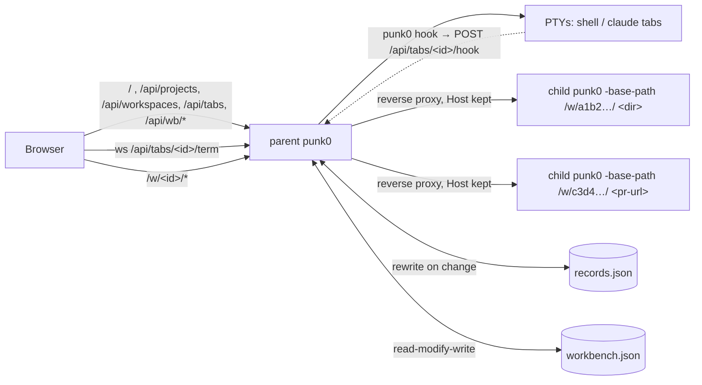

# Orchestrator Internals

The orchestrator (`workbench.go`, `records.go`, `term*.go`, `ring.go`, `hook.go`, `web/workbench.{html,css}`, `web/src/workbench.js`, `web/src/orch/*.js`) is what `punk0` serves for everything except `punk0 <pr-url>`. The parent process owns the agents page, the records (projects, workspaces, tabs) and every terminal. It holds no index and no language servers: every folder or pull request is served by a separate child punk0 behind a reverse proxy.

## Why child processes

`Server` is built around a single workspace: one `Index`, `lspManager`, `agentManager`, `prSession`, `GitWatcher` and `diffBase`, all fixed in `main()`. Rather than threading a workspace ID through every handler, the parent re-runs the punk0 binary per folder. Each child keeps px0's single-folder performance, a crashing or memory-hungry language server only takes down its own child, and stopping a child frees everything it held. Terminals stay in the parent, so stopping a child never kills a shell or an agent.



## Launch and hand-off

`main` sends every non-PR invocation without `-workbench-child` to `runWorkbench`, with `-no-lsp`, `-no-git`, `-no-agent`, `-no-telemetry` and `-agent` collected as the children's flags. `runningWorkbench` checks `workbench.lock`; if a punk0 answers there, `handOff` POSTs the folder to its `/api/projects` (with a matching `Origin`), opens the returned editor URL and exits. A bare second `punk0` just opens the running page. Otherwise `runWorkbench` listens, writes the lock, writes `claude-hooks.json` and the hook base URL (`serveFrom`), registers `punk0 <dir>`'s folder with `Records.Open`, and opens the agents page and that folder's editor.

The page sets `window.name = 'punk0-agents'`; `openEditor` opens editors in `punk0-w-<id>`, and the editor's back link (`web/src/main.js`) targets `punk0-agents`, so each page reuses its own browser tab.

## Records (`records.go`)

`Records` holds `Project → Workspace → Satellite` (tab) and a per-folder `lsp` map, and rewrites `<state>/records.json` on each change. `OpenRecords` refuses a file that does not parse, so a later save cannot overwrite it, and always adds the Scratch project.

- **Projects.** `AddProject` registers a git repository's top level (or a plain folder). A new project starts with one local workspace holding one shell tab, plus any worktrees punk0 made for it before it was removed.
- **Workspace kinds.** `local` shares the project folder; `worktree` owns exactly one worktree at `<state>/worktrees/<project-id>/<name>`, so deleting it can never pull files from under another, and deleting a dirty one needs `?force=1` (409 `dirty` otherwise); `folder` is a scratch chat under `<state>/scratch`.
- **Tabs.** `shell` or `claude`. Running shells are never saved: after a restart every tab is stopped and starts again on attach.
- **Folder IDs.** A folder's child is keyed `wbItemID("dir", ws.Dir)`, so local workspaces of one project share a child. `Records.Folder(id)` resolves a `/w/<id>/` back to its folder.

## Terminals (`term.go`, `term_unix.go`, `term_windows.go`, `ring.go`)

`Satellite.Shell` starts the tab's shell in a PTY on first attach (`startShell`), in the workspace folder, with `PUNK0_HOOK_URL` in its environment. A claude tab runs `claude --settings <state>/claude-hooks.json --resume <uuid> || … --session-id <uuid>`, or only `--session-id` for a chat made this run, so the chat resumes across restarts.

- **Transport.** `GET /api/tabs/{id}/term` upgrades to a websocket: binary frames carry bytes both ways, text frames carry `{"cols","rows"}`. Frames may be up to 8 MiB.
- **Scrollback.** Each shell keeps its last 256 KiB in a `ring`; `Attach` replays it and then streams live output, with nothing lost or repeated between the two. A viewer more than 256 reads behind is disconnected (`StatusTryAgainLater`) and reattaches from scrollback.
- **Lifetime.** Shells outlive websockets. `Shell.Close` hangs up the process group (SIGHUP on Unix). `workbench.Close` stops the terminals first, then every child in parallel.
- **Loopback only.** `handleTerm` returns 403 unless the parent listens on loopback (`localOnly`).

## Hooks (`hook.go`)

`writeClaudeHooks` writes `<state>/claude-hooks.json`, registering `<this punk0> hook` for `SessionStart`, `UserPromptSubmit`, `PreToolUse`, `PostToolUse`, `PostToolUseFailure`, `PermissionRequest`, `Notification`, `Stop`, `StopFailure` and `SessionEnd`. `punk0 hook` (`runHook`) posts the event from stdin to `PUNK0_HOOK_URL` (`<loopback base>api/tabs/<id>/hook`) and stays silent, since hook output would show up in the agent's chat. `handleHook` goes through the same `Origin` check as other changes. `hookStatus` maps events to `working` (prompt, tool use, or a stop with background tasks still running), `waiting` (permission request, permission or elicitation notification), `idle` (session start, stop, idle notification) or none (session end).

## Children

`workbench.start` runs:

```
punk0 [passed-on flags] -workbench-host <host> -workbench-child -host 127.0.0.1 -port 0 -no-open -no-update -no-color -base-path <base>w/<id>/ [-no-lsp] <dir | pr-url>
```

- **Language servers.** A folder child gets `-no-lsp` unless `Records.LSPOn(dir)`; a parent started with `-no-lsp` already passes it to all. `POST /api/workspaces/{id}/lsp` stores the choice and stops the folder's child, since the flag is read only when a child starts; the next request starts one that matches.
- **Readiness.** With `-workbench-child`, `main` prints `px0-ready <addr>` once it is listening. The parent reads child output through `lineWriter`, which also drops spinner frames (`\r`), and keeps the last 20 lines; `wbChild.failure` reports the last `punk0: …` line as the error.
- **Lifetime.** The parent holds the child's stdin. The child treats EOF on stdin as SIGTERM and shuts down the normal way, which removes PR worktrees and stops language servers. This works if the parent is stopped, crashes or is killed, on every platform. `stop` closes stdin and kills the child after 5 seconds. `cmd.WaitDelay` keeps a grandchild holding the output pipes from blocking `Wait`.
- **States.** `starting` → `running` → `stopped`, or `failed` if the child exits before it is ready or takes longer than `wbStartTimeout` (3 minutes; a PR may clone a large repository). Live state is kept only in memory.
- **PR clones.** `checkoutPR` makes a worktree when its working directory is a clone of the PR's repository, so the parent starts every PR child in one (see below). Before the child is launched, `run` resolves the clone, or makes one, while the state is `starting` and `progress` says what it is waiting on. `stop` cancels this through `wbChild.ctx`.

## Idle stop

`reapIdle` ticks every minute and re-reads settings each time, so a change applies without a restart; `idleLimit` treats `0` as never.

- **Children.** The proxy counts requests in flight per child and records when the last one ended. A running child with none in flight for `workspace.idleStop` minutes (default 5) is stopped.
- **Terminals.** A tab whose PTY has carried nothing for `terminal.idleStop` minutes (default 30) is closed if `stopIdleTab` allows it: a shell only when the PTY's foreground process group is the shell itself (`TIOCGPGRP`; never on Windows), a claude tab only when its hook status is `idle`.

## PR clones (`workbench_clone.go`)

Every PR is a worktree of one local clone per repository; nothing is cloned per PR.

- **Matching.** `findPRRemote(dir, owner, repo)` (pr.go) returns the clone's top level and the name of the remote that points at the repository. It checks `origin` first, then `upstream` (a fork), then any other remote. `remoteMatchesRepo` compares the parsed `owner/repo` of https, ssh and scp-style URLs exactly, ignoring case. `checkoutPR`, `computeDiffBase` and `Pull` fetch from that remote rather than assuming `origin`. An empty remote name still means `origin`.
- **Finding.** `findClone` tries `knownClone` first: the clone remembered in `workbench.json` (`clones`, keyed by lowercased `owner/repo`), then the registered project folders (`Records.ProjectDirs`), then the parent's cwd. Failing that, `scanForClone` searches the usual code folders under home, the parents of the project folders and around the cwd, breadth-first, three levels deep. It skips hidden and dependency folders, looks at no more than 20,000 entries and gives up after 1.5 seconds, and it only considers folders named like the repository that hold a `.git`. A clone found this way is remembered.
- **Asking.** `/api/wb/open` checks for a clone before it records a PR. With none, it returns `{needClone, repo, managed}` and the sidebar asks. The next request passes `clone`, either a folder (verified with `cloneOf`, then remembered) or `"managed"`.
- **punk0's own clone.** `makeClone` clones once into `<state>/repos/<owner>/<repo>`, as a partial clone (`--filter=blob:none`) with no checkout of its own. It clones into a sibling temp folder and renames it into place, so an interrupted clone never looks finished. A per-repository mutex keeps two PRs opened together from cloning twice.
- **Credentials.** `gitLocalThenToken` runs the head fetch and `worktree add` with the clone's own git credentials first, and with the forge token only if that fails. A partial clone fetches file contents during `worktree add`, which a private repository's token covers.
- **Reopening.** A PR whose clone has disappeared fails with `errNoClone`. The holding page then offers **Choose a clone**, which links to the agents page with `?open=<url>`.
- **CLI.** `main` passes `knownClone`'s result (the remembered clone and the project folders read from `records.json` by `recordedProjectDirs`, no scan) to `checkoutPR` when `punk0 <pr-url>` runs outside a matching clone.

## Proxy

`/w/<id>/…` goes to the child's `httputil.ReverseProxy`, which has `FlushInterval: -1` so event streams are not buffered. The proxy keeps the browser's `Host` header, so the child's `localPost` check, which compares `Host` with `Origin`, still passes. The child serves under its own base path, and its `/api/meta` reports `workbench`, the parent's base path. The editor uses it for the back link and to send **Git: Open Pull Request…** to `/api/wb/open` instead of `/api/pr/launch`.

Any request for a known folder or PR starts its child. A GET of the editor page itself (`/w/<id>/`) returns a holding page that refreshes every second until the child is ready, or shows the error with **Retry**. Other requests (the agents page's tree, file and finder calls) wait up to `wbAPIWait` (30 seconds) for the child, then get 503. An unknown ID is 404.

## Page

`web/workbench.html` is driven by `web/src/workbench.js`, a second bundle entry in `scripts/build-web.js` (output `web/workbench.js`, gitignored like `app.js`). It uses the modules under `web/src/orch/`: `store.js` (state from `/api/projects` and `/api/wb/state`, selection), `sidebar.js` (projects, workspaces, Scratch, Reviews, the add form and the clone question), `complete.js` (folder completion from `/api/wb/complete`), `tabs.js` (terminal and file tabs), `term.js` (xterm.js from `web/vendor/xterm*` over the terminal websocket), `tree.js`, `viewer.js` and `picker.js` (file tree, read-only viewer and file finder through the folder's child: `w/<id>/api/tree`, `api/file`, `api/find`), `statusbar.js` and `api.js`. It shares `state.js`, `theme.js` and `metricsview.js` with the editor. The parent's `/api/metrics` sums its own process with each running child's `/api/metrics`, fetched directly rather than through the proxy so the polling does not count against idle stop. `/api/settings` on the parent only accepts `workbench.colorTheme`.

## Item IDs

`wbItemID` is the first 6 bytes, as hex, of the SHA-256 of the kind plus a key: the cleaned absolute path for a directory, or the lowercased `provider/owner/repo#n` for a pull request. The ID is stable, so `/w/<id>/` is stable. A PR's review drafts are saved in a session file named after the same ID (`prSessionFilePath`), so they survive a reopen, from the agents page or from `punk0 <pr-url>`, even though each opening checks the PR out into a new temporary directory.

## Store

`workbench.json` holds only the Reviews list (PR items, the 50 most recent) and the remembered clones; folders live in `records.json`, and `load` drops any directory items an older file still has. `wbStore` keeps nothing in memory. Each change re-reads the file, applies the change and writes it back atomically (temp file + rename). A plain `punk0 <pr-url>` records itself through `recordRecent`, so the parent must not overwrite entries it never loaded. An unparseable file is renamed to `workbench.json.bad` rather than overwritten.

A PR added by `/api/wb/open` that fails before its child is ready is removed again (`forget`), so a mistyped URL does not stay in the list. The holding page still shows the error from the in-memory child.

## Single instance

`workbench.lock`, next to `workbench.json`, records the parent's PID and loopback URL. A second punk0 pings `/api/wb/ping` there and hands off to it if it answers (see above). Only the process that wrote the lock removes it.

## Security

`/api/wb/complete` lists folders anywhere on disk, and `/api/projects` and `/api/wb/open` can start a child on any of them. Requests that change anything go through `localPost` or `localOrigin`: a `Host` that is an IP address or localhost, and an `Origin` that matches it. GET requests for state and folder listings, and the editor page, go through `trustedGet`, which applies the same `Host` check against DNS rebinding. Terminals are served only while the parent listens on loopback. Children bind only to 127.0.0.1 and can be reached only through the proxy. When bound to a non-loopback address, punk0 prints a warning that anyone who can reach it can browse the machine.
